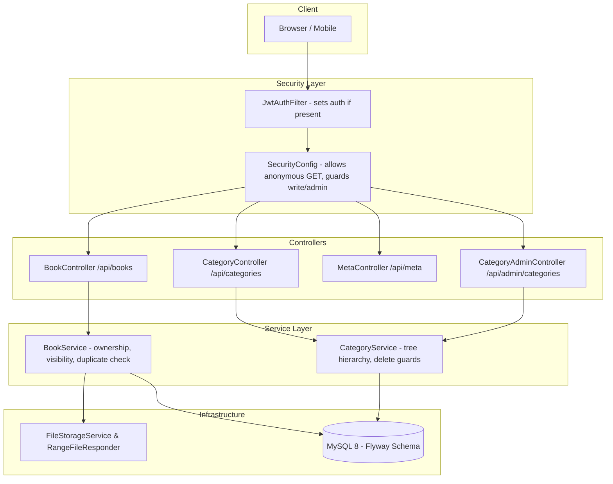

# Implementation Plan - Phase 3: Categories and Books

## 1. Goal Description
Phase 3 delivers the first complete vertical content slice of the library system. It allows teachers and librarians to create categories, upload and manage books (PDFs, EPUBs, Office documents, covers) with deduplication, and allows anonymous students over Wi-Fi to browse, filter, search (via MySQL FULLTEXT / LIKE), stream inline via HTTP Range requests, and download materials.

---

## 2. User Review Required

> [!IMPORTANT]
> **1. SecurityConfig Matching Order**:
> `/api/books/mine` is a `GET` request requiring authentication. We must configure `.requestMatchers("/api/books/mine").authenticated()` **before** `.requestMatchers(HttpMethod.GET, "/api/books/**").permitAll()` in `SecurityConfig`, otherwise the wildcard match would permit unauthenticated calls to `/api/books/mine` and trigger a `NullPointerException` on the user principal.
>
> **2. Duplicate Detection Strategy**:
> Checksum duplicate checks (`checksum_sha256`) occur **after** streaming the upload to disk and computing the hash, but **before** committing the database transaction. If a book with the same checksum exists (`deleted_at IS NULL`), the newly uploaded file is immediately purged from disk and an HTTP `409 Conflict` (`DUPLICATE_FILE`) is returned.
>
> **3. Multipart JSON Upload Format**:
> The `POST /api/books` endpoint will accept `multipart/form-data` with:
> - `file` (`MultipartFile`, required)
> - `cover` (`MultipartFile`, optional)
> - `metadata` (`@RequestPart("metadata") BookMetadataRequest` or JSON string, required)

---

## 3. Open Questions
* None. All requirements strictly align with [backend-spec.md](file:///c:/Users/lenovo/Documents/GitHub/TPLM/backend_sman_11_garut_library/backend-spec.md) and [backend-architecture.md](file:///c:/Users/lenovo/Documents/GitHub/TPLM/backend_sman_11_garut_library/backend-architecture.md).

---

## 4. Proposed Architecture & Component Flow



---

## 5. Proposed Changes

### Component 1: Common Pagination

#### [NEW] `library/src/main/java/id/sch/sman11garut/library/common/PageResponse.java`
Standard paginated API response wrapper matching frontend expectations:
```java
public record PageResponse<T>(
    List<T> content,
    int page,
    int size,
    long totalElements,
    int totalPages,
    boolean last
) {
    public static <T> PageResponse<T> from(Page<T> page) {
        return new PageResponse<>(
            page.getContent(),
            page.getNumber(),
            page.getSize(),
            page.getTotalElements(),
            page.getTotalPages(),
            page.isLast()
        );
    }
}
```

---

### Component 2: Categories Feature (`id.sch.sman11garut.library.category`)

#### [NEW] `CategoryType.java`
Enum: `BOOK`, `ARCHIVE`.

#### [NEW] `BookCategory.java`
Entity mapped to table `book_categories`:
- `id` (`INT UNSIGNED AUTO_INCREMENT`)
- `name` (`VARCHAR(100) UNIQUE NOT NULL`)
- `parentId` (`INT UNSIGNED NULL`) / self-referencing relationship

#### [NEW] `BookCategoryRepository.java`
- `Optional<BookCategory> findByName(String name)`
- `boolean existsByName(String name)`
- `boolean existsByNameAndIdNot(String name, Integer id)`
- `List<BookCategory> findAllByOrderByOrderByNameAsc()`
- `List<BookCategory> findByParentIsNullOrderByNameAsc()`
- `@Query(value = "SELECT COUNT(*) FROM books WHERE category_id = :categoryId AND deleted_at IS NULL", nativeQuery = true)`: Direct count check preventing circular dependency with `BookService`.

#### [NEW] `CategoryDto.java`, `CreateCategoryRequest.java`, `UpdateCategoryRequest.java`
- `CategoryDto(Integer id, String name, Integer parentId, List<CategoryDto> children)`
- Request DTOs with `@NotBlank` and `@Size(max = 100)`.

#### [NEW] `CategoryService.java`
- `listCategories(CategoryType type)`: Returns categories as a flat list or hierarchical tree.
- `createCategory(CreateCategoryRequest request)`: Validates unique name.
- `updateCategory(Integer id, UpdateCategoryRequest request)`: Updates name and parent (guards against cyclic nesting).
- `deleteCategory(Integer id)`: Verifies that no active books (`deleted_at IS NULL`) are assigned using `bookCategoryRepository.countActiveBooks(id)` before deleting (eliminates circular bean references).

#### [NEW] `CategoryController.java` (`GET /api/categories`)
- Public endpoint supporting `?type=BOOK|ARCHIVE` (defaults to `BOOK`).

#### [NEW] `CategoryAdminController.java` (`/api/admin/categories`)
- Protected by `@PreAuthorize("hasRole('LIBRARIAN')")`:
  - `POST /api/admin/categories`
  - `PUT /api/admin/categories/{id}`
  - `DELETE /api/admin/categories/{id}`

---

### Component 3: Metadata Filters (`id.sch.sman11garut.library.meta`)

#### [NEW] `MetaFiltersDto.java` & `MetaController.java` (`GET /api/meta/filters`)
Returns allowed dropdown options for search filters:
- `gradeLevels`: `["X", "XI", "XII", "ALL"]`
- `bookTypes`: `["EBOOK", "TEACHING_MODULE", "QUESTION_BANK", "SLIDES", "OTHER"]`
- `curricula`: `["K13", "Kurikulum Merdeka", "Umum"]`

---

### Component 4: Books Feature (`id.sch.sman11garut.library.book`)

#### [NEW] Enums
- `BookType`: `EBOOK`, `TEACHING_MODULE`, `QUESTION_BANK`, `SLIDES`, `OTHER`
- `GradeLevel`: `X`, `XI`, `XII`, `ALL`
- `Visibility`: `PUBLIC`, `STAFF`

#### [NEW] `Book.java`
Entity mapped to table `books`:
- `id` (`Long`)
- `title`, `author`, `publisher`
- `publicationYear`: `Short` matching MySQL `SMALLINT` for strict `ddl-auto: validate` compatibility, with overloaded `setPublicationYear(Integer)` setter.
- `description`, `bookType`, `gradeLevel`, `curriculum`, `visibility`
- `originalName`, `storedPath`, `mimeType`, `fileSize`
- `checksumSha256`: `columnDefinition = "CHAR(64)"`
- `coverPath`, `downloadCount` (default `0`)
- `category` (`@ManyToOne BookCategory`)
- `uploadedBy` (`@ManyToOne User`)
- `createdAt`, `updatedAt`, `deletedAt`

#### [NEW] `BookRepository.java` & `BookSpecifications.java`
- Spring Data JPA Repository extending `JpaSpecificationExecutor<Book>`.
- `boolean existsByChecksumSha256AndDeletedAtIsNull(String checksum)`: For duplicate detection.
- `boolean existsByCategoryIdAndDeletedAtIsNull(Integer categoryId)`: For category deletion safety check.
- `Page<Book> findByUploadedByIdAndDeletedAtIsNullOrderByCreatedAtDesc(Long userId, Pageable pageable)`: For `/api/books/mine`.
- **Search Specification (`BookSpecifications.java`)**:
  - `deletedAt IS NULL`
  - Visibility rule: If anonymous/student, `visibility = Visibility.PUBLIC`. If staff (`TEACHER` or `LIBRARIAN`), shows both `PUBLIC` and `STAFF`.
  - Filter criteria: `categoryId`, `gradeLevel`, `bookType`.
  - Keyword search (`q`):
    - When `q.length() >= 3`: MySQL FULLTEXT search `MATCH(title, author, description) AGAINST (:q IN NATURAL LANGUAGE MODE)` using JPA native query.
    - When `q.length() < 3`: Fallback to `LIKE %:q%` across `title`, `author`, `description`.

#### [NEW] DTOs
- `BookSummaryDto`: Compact representation for search/list grids (id, title, author, bookType, gradeLevel, coverPath, downloadCount, visibility, categoryName).
- `BookDetailDto`: Full metadata representation including file size, mime type, publisher, publication year, uploadedBy info.
- `BookMetadataRequest`: Incoming JSON payload for book creation.
- `UpdateBookRequest`: Incoming payload for metadata updates.

#### [NEW] `BookService.java`
- `listBooks(BookSearchCriteria criteria, boolean isStaff, Pageable pageable)`: Returns `PageResponse<BookSummaryDto>`.
  - Uses `resolveNativePageable` with database column names (`created_at`, `download_count`, `title`) when executing native FULLTEXT queries to prevent SQL `Unknown column` syntax errors.
  - Uses `resolveJpaPageable` with entity property names (`createdAt`, `downloadCount`, `title`) when executing JPA criteria queries.
- `getBook(Long id, boolean isStaff)`: Returns `BookDetailDto`. Throws `404 Not Found` if book is `STAFF` and caller is anonymous, or if soft-deleted.
- `streamBookFile(Long id, boolean isStaff, HttpServletRequest request, HttpServletResponse response)`: Resolves file path and delegates to `RangeFileResponder.write(...)`.
- `downloadBookFile(Long id, boolean isStaff, HttpServletRequest request, HttpServletResponse response)`: Adds `Content-Disposition: attachment; filename="..."`, increments `downloadCount`, and streams file.
- `getBookCover(Long id, HttpServletRequest request, HttpServletResponse response)`: Streams cover image or serves fallback SVG placeholder.
- `createBook(MultipartFile file, MultipartFile cover, BookMetadataRequest metadata, UserPrincipal principal)`:
  - Validates and stores `file` via `FileStorageService.storeFile(..., StorageCategory.BOOK)`.
  - Checks duplicate checksum: if already exists, deletes the uploaded file and throws `AppException.conflict("DUPLICATE_FILE", "...")`.
  - If `cover` provided, stores via `FileStorageService.storeFile(..., StorageCategory.COVER)`.
  - Saves entity with compensation: if DB save throws an error, stored files are deleted immediately.
- `updateBook(Long id, UpdateBookRequest request, UserPrincipal principal)`: Enforces ownership (Teacher can only update own; Librarian can update any).
- `replaceBookFile(Long id, MultipartFile file, UserPrincipal principal)`: Stores new file, updates DB, deletes old file from disk. Enforces ownership.
- `deleteBook(Long id, UserPrincipal principal)`: Soft delete (`deletedAt = Instant.now()`). Enforces ownership.
- `restoreBook(Long id)`: Undoes soft delete (Librarian only).
- `listMyBooks(UserPrincipal principal, Pageable pageable)`: Lists uploads by current authenticated user.

#### [NEW] `BookController.java` (`/api/books/**`)
- Public / Teacher / Librarian routes:
  - `GET /api/books`
  - `GET /api/books/{id}`
  - `GET /api/books/{id}/file`
  - `GET /api/books/{id}/download`
  - `GET /api/books/{id}/cover`
  - `GET /api/books/mine` (`@AuthenticationPrincipal`)
  - `POST /api/books` (multipart)
  - `PUT /api/books/{id}`
  - `PUT /api/books/{id}/file`
  - `DELETE /api/books/{id}`

#### [NEW] `BookAdminController.java` (`/api/admin/books`)
- `POST /api/admin/books/{id}/restore` (`@PreAuthorize("hasRole('LIBRARIAN')")`)

---

### Component 5: Security Configuration Adjustment

#### [MODIFY] `library/src/main/java/id/sch/sman11garut/library/config/SecurityConfig.java`
Ensure `/api/books/mine` and `/api/archive/mine` are explicitly authenticated before general GET matches:
```diff
--- a/SecurityConfig.java
+++ b/SecurityConfig.java
@@ -67,6 +67,9 @@
+                // Authenticated user operations (Teacher + Librarian)
+                .requestMatchers("/api/auth/me", "/api/auth/change-password").authenticated()
+                .requestMatchers("/api/books/mine", "/api/archive/mine").authenticated()
+
                 // Public catalog browsing (anonymous students)
                 .requestMatchers(HttpMethod.GET, "/api/books/**").permitAll()
                 .requestMatchers(HttpMethod.GET, "/api/archive/**").permitAll()
```

---

## 6. Verification Plan

### Automated Verification
```powershell
mvn test-compile -f library/pom.xml
```

### Manual Testing Guide (Executable PowerShell & Curl Commands)

Start the application:
```powershell
cd c:\Users\lenovo\Documents\GitHub\TPLM\backend_sman_11_garut_library\library
mvn spring-boot:run
```

#### 1. Public Categories & Metadata
```powershell
# List book categories (public)
Invoke-RestMethod -Uri http://localhost:8081/api/categories?type=BOOK

# Filter metadata options
Invoke-RestMethod -Uri http://localhost:8081/api/meta/filters
```

#### 2. Category Management (Librarian)
```powershell
$adminLogin = @{ username = "admin"; password = "admin123" } | ConvertTo-Json
$token = (Invoke-RestMethod -Uri http://localhost:8081/api/auth/login -Method Post -ContentType "application/json" -Body $adminLogin).token
$adminHeaders = @{ Authorization = "Bearer $token" }

$catBody = @{
    name = "Koleksi Khusus"
    type = "BOOK"
} | ConvertTo-Json

Invoke-RestMethod -Uri http://localhost:8081/api/admin/categories -Method Post -ContentType "application/json" -Headers $adminHeaders -Body $catBody
```

#### 3. Book Upload (Teacher / Librarian)
Upload a book with `multipart/form-data`:
```powershell
curl -X POST http://localhost:8081/api/books `
  -H "Authorization: Bearer $token" `
  -F "file=@sample.pdf;type=application/pdf" `
  -F "metadata={\"title\":\"Buku Matematika SMA\",\"author\":\"Drs. Suryono\",\"bookType\":\"EBOOK\",\"gradeLevel\":\"X\",\"visibility\":\"PUBLIC\"};type=application/json"
```

#### 4. Duplicate Rejection Check
Re-run the exact same upload command with `sample.pdf`.
* **Expected result:** HTTP `409 Conflict` with code `"DUPLICATE_FILE"`.

#### 5. Anonymous Browsing & HTTP Range Streaming
```powershell
# Anonymous search by keyword (FULLTEXT)
Invoke-RestMethod -Uri "http://localhost:8081/api/books?q=matematika"

# Test HTTP Range streaming (first 512 bytes)
curl -i -H "Range: bytes=0-511" http://localhost:8081/api/books/1/file
```
* **Expected result:** HTTP `206 Partial Content` with `Content-Range: bytes 0-511/{total}`.

#### 6. Soft Delete & Restore
```powershell
# Delete book
curl -X DELETE -H "Authorization: Bearer $token" http://localhost:8081/api/books/1

# Verify it disappears from catalog
Invoke-RestMethod -Uri "http://localhost:8081/api/books/1" # Expect 404

# Restore book as Librarian
curl -X POST -H "Authorization: Bearer $token" http://localhost:8081/api/admin/books/1/restore
```
