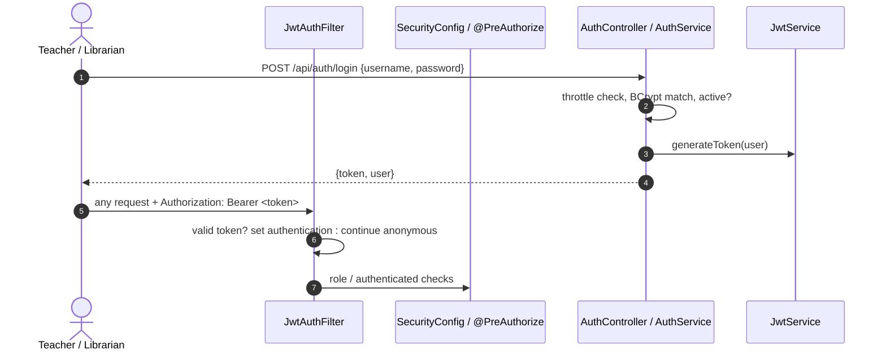

# Phase 1: Auth and Users

> **Status:** Done · **Commit:** `50c510e` · **Roadmap:** [Phase 1](backend-phases.md#phase-1-auth-and-users) · **Spec:** [Roles & access](backend-spec.md#2-roles--access)

## 1. Summary

Stateless JWT login for staff, with anonymous access kept open for students.
- **Anonymous**: students browse and read public content without accounts.
- **Staff**: `TEACHER` and `LIBRARIAN` log in via `POST /api/auth/login` and get a JWT valid for 8 hours.
- **Roles**: write and admin endpoints are protected; public reads stay open.
- **User admin**: librarians create teachers, reset passwords and deactivate accounts.

**Done when:** a librarian can log in and create a teacher, the teacher can log in, and role-protected endpoints reject anonymous callers.

---

## 2. Decisions

- **The JWT filter never rejects a request.** If the token is missing or invalid, the request continues as anonymous. Access is decided afterwards by `SecurityConfig` and `@PreAuthorize`, so public endpoints stay open while staff still see `STAFF` items.
- **`/error` is permitted.** Otherwise Spring's error dispatcher turns 400/404/405 responses into a misleading 401.
- **First librarian from environment variables.** On startup, if no LIBRARIAN exists, one is created from `ADMIN_USERNAME` / `ADMIN_PASSWORD` (dev fallback `admin` / `admin123`). No password is committed to the schema.
- **Login throttling** is in memory: repeated failures lock the username for 5 minutes (`ACCOUNT_TEMPORARILY_LOCKED`).
- **Librarians can't lock themselves out**: they can't deactivate their own account or the last active librarian.

---

## 3. Design



Token claims: `sub` (username), `userId`, `role`, `fullName`; signed with HMAC-SHA256.

---

## 4. Changes

| File | Change | Notes |
|---|---|---|
| `pom.xml` | Modified | `jjwt-impl`, `jjwt-jackson` (runtime) for `jjwt-api 0.13.0`. |
| `config/JwtProperties.java` | New | `app.jwt.secret`, `app.jwt.expiry-hours` (8). |
| `config/SecurityConfig.java` | New | Stateless chain, BCrypt bean, `@EnableMethodSecurity`, JSON 401 entry point. Public: login, `/error`, health, docs, catalog GETs. Authenticated: `/api/auth/me`, `/api/auth/change-password`. LIBRARIAN: `/api/admin/**`. |
| `config/JwtAuthFilter.java` | New | Reads `Bearer` token, sets authentication if valid, never blocks. |
| `auth/JwtService.java` | New | Generate and validate tokens. |
| `auth/CustomUserDetailsService.java` | New | Loads active users. |
| `auth/LoginThrottlingService.java` | New | In-memory failed-attempt counter. |
| `auth/AuthService.java`, `auth/AuthController.java` | New | Login, current user, change password. |
| `auth/LoginRequest`, `LoginResponse`, `ChangePasswordRequest` | New | DTOs (`newPassword` min 6 chars). |
| `user/User`, `UserRepository`, `Role` | New | Entity for `users`. |
| `user/UserService.java`, `user/UserAdminController.java` | New | List, get, create (default role TEACHER), update (name, password, active). |
| `user/UserDto`, `CreateUserRequest`, `UpdateUserRequest` | New | DTOs. |
| `user/AdminUserSeeder.java` | New | Seeds the first librarian. |

---

## 5. API

| Method | Path | Access | Result |
|---|---|---|---|
| POST | `/api/auth/login` | Public | `200` `{token, user}` |
| GET | `/api/auth/me` | Staff | `200` user |
| POST | `/api/auth/change-password` | Staff | `200` `{"message": "Password changed successfully"}` |
| GET | `/api/admin/users`, `/api/admin/users/{id}` | Librarian | `200` user(s) |
| POST | `/api/admin/users` | Librarian | `201` user |
| PUT | `/api/admin/users/{id}` | Librarian | `200` user |

Errors: `INVALID_CREDENTIALS`, `ACCOUNT_TEMPORARILY_LOCKED`, `INVALID_OLD_PASSWORD`, `SAME_PASSWORD`, `DUPLICATE_USERNAME`, `CANNOT_DEACTIVATE_SELF`, `CANNOT_DEACTIVATE_LAST_LIBRARIAN`, `UNAUTHORIZED`, `FORBIDDEN`. See the [error catalog](backend-spec.md#4-errors).

---

## 6. Testing

### 6.1 Automated
None specific to this phase yet (integration tests are planned for Phase 8).

### 6.2 Manual (Postman)

#### Setup
| Variable | Initial Value | Notes |
|---|---|---|
| `baseUrl` | `http://localhost:8081` | Dev backend server port |
| `adminToken` | *(empty)* | Set by Request 1 |
| `teacherToken` | *(empty)* | Set by Request 4 |

---

#### Request 1: Admin Login
* **Method**: `POST`
* **URL**: `{{baseUrl}}/api/auth/login`
* **Headers**:
  * `Content-Type: application/json`
* **Body** (`raw` - JSON):
  ```json
  {
    "username": "admin",
    "password": "admin123"
  }
  ```
* **Postman Tests Script**:
  ```javascript
  pm.test("Status code is 200", function () {
      pm.response.to.have.status(200);
      pm.environment.set("adminToken", pm.response.json().token);
  });
  ```
* **Expected Response** (`200 OK`):
  ```json
  {
    "token": "eyJhbGciOiJIUzI1NiJ9...",
    "user": {
      "id": 1,
      "username": "admin",
      "fullName": "Petugas Perpustakaan",
      "role": "LIBRARIAN",
      "active": true,
      "createdAt": "2026-11-10T03:00:00Z"
    }
  }
  ```

---

#### Request 2: Get Current User Profile
* **Method**: `GET`
* **URL**: `{{baseUrl}}/api/auth/me`
* **Headers**:
  * `Authorization: Bearer {{adminToken}}`
* **Expected Response** (`200 OK`): the same `user` object as in Request 1.

---

#### Request 3: Create Teacher Account (Librarian Only)
* **Method**: `POST`
* **URL**: `{{baseUrl}}/api/admin/users`
* **Headers**:
  * `Content-Type: application/json`
  * `Authorization: Bearer {{adminToken}}`
* **Body** (`raw` - JSON):
  ```json
  {
    "username": "guru_matematika",
    "password": "password123",
    "fullName": "Budi Santoso, S.Pd.",
    "role": "TEACHER"
  }
  ```
* **Expected Response** (`201 Created`, header `Location: /api/admin/users/2`):
  ```json
  {
    "id": 2,
    "username": "guru_matematika",
    "fullName": "Budi Santoso, S.Pd.",
    "role": "TEACHER",
    "active": true,
    "createdAt": "2026-11-10T03:05:00Z"
  }
  ```

---

#### Request 4: Teacher Login
* **Method**: `POST`
* **URL**: `{{baseUrl}}/api/auth/login`
* **Headers**:
  * `Content-Type: application/json`
* **Body** (`raw` - JSON):
  ```json
  {
    "username": "guru_matematika",
    "password": "password123"
  }
  ```
* **Postman Tests Script**:
  ```javascript
  pm.test("Status code is 200", function () {
      pm.response.to.have.status(200);
      pm.environment.set("teacherToken", pm.response.json().token);
  });
  ```
* **Expected Response** (`200 OK`): `token` plus the teacher's `user` object with `"role": "TEACHER"`.

---

#### Request 5: Teacher Is Forbidden on Admin Endpoint
* **Method**: `GET`
* **URL**: `{{baseUrl}}/api/admin/users`
* **Headers**:
  * `Authorization: Bearer {{teacherToken}}`
* **Expected Response** (`403 Forbidden`):
  ```json
  {
    "status": 403,
    "code": "FORBIDDEN",
    "message": "You do not have permission to do this"
  }
  ```

---

#### Request 6: Anonymous Is Rejected on Protected Endpoint
* **Method**: `GET`
* **URL**: `{{baseUrl}}/api/auth/me`
* **Headers**: *(None)*
* **Expected Response** (`401 Unauthorized`):
  ```json
  {
    "status": 401,
    "code": "UNAUTHORIZED",
    "message": "Full authentication is required to access this resource"
  }
  ```

---

#### Request 7: Change Password
* **Method**: `POST`
* **URL**: `{{baseUrl}}/api/auth/change-password`
* **Headers**:
  * `Content-Type: application/json`
  * `Authorization: Bearer {{teacherToken}}`
* **Body** (`raw` - JSON):
  ```json
  {
    "oldPassword": "password123",
    "newPassword": "newPassword456"
  }
  ```
* **Expected Response** (`200 OK`):
  ```json
  {
    "message": "Password changed successfully"
  }
  ```
  *(Logging in with the old password now returns `400 INVALID_CREDENTIALS`.)*

---

#### Request 8: Anonymous Health Check
* **Method**: `GET`
* **URL**: `{{baseUrl}}/actuator/health`
* **Headers**: *(None)*
* **Expected Response** (`200 OK`): `{"status": "UP", ...}` (the dev profile also shows component details).

---

## 7. Issues and fixes

| Issue | Cause | Fix |
|---|---|---|
| 400/404/405 errors came back as `401 Unauthorized`. | Spring forwards errors to `/error`, which was not permitted, so security answered 401. | `/error` added to `permitAll()` in `SecurityConfig`. |
