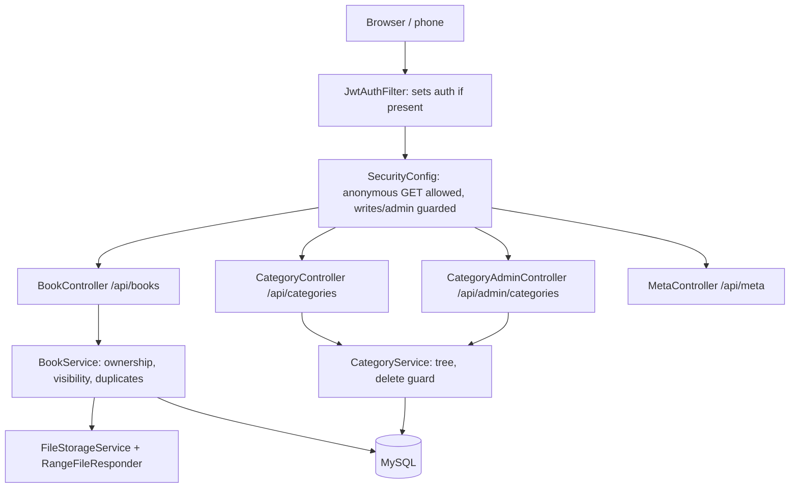

# Phase 3: Categories and Books

> **Status:** Done · **Commit:** `d45adf8` · **Roadmap:** [Phase 3](backend-phases.md#phase-3-categories-and-books) · **Spec:** [Books endpoints](backend-spec.md#31-public-books)

## 1. Summary

The first complete content slice and the first one the front-end can integrate against.
- **Categories**: separate, optionally nested trees for books and archive; public list, librarian CRUD.
- **Books**: upload (PDF, EPUB, Office) with an optional cover, edit, replace file, soft delete, restore.
- **Ownership**: teachers edit only their own books; librarians edit any.
- **Browse**: paged list with filters and full-text search, inline reading (HTTP Range), download, cover.
- **Filter options**: `GET /api/meta/filters` for front-end dropdowns.

**Done when:** a teacher uploads a PDF, an anonymous user finds it by search and opens it in the browser, and a teacher can't edit another teacher's book.

---

## 2. Decisions

- **Matcher order in `SecurityConfig`.** `/api/books/mine` and `/api/archive/mine` are declared `authenticated()` *before* the public `GET /api/books/**` rule. Otherwise the wildcard lets anonymous callers in and the missing principal causes a `NullPointerException`.
- **Duplicate check after streaming.** The file is stored and hashed first; if the checksum already exists, the new file is deleted and `409 DUPLICATE_FILE` is returned. *(Since Phase 6 this includes soft-deleted books, matching the DB unique key.)*
- **Upload format.** `multipart/form-data` with `file` (required), `cover` (optional) and `metadata` (JSON part, required).
- **STAFF books are hidden, not forbidden.** Anonymous requests for them return 404.
- **Search has two paths.** Queries of 3+ characters use a native MySQL `MATCH ... AGAINST` query; shorter ones use a JPA Specification with `LIKE`. Sorting therefore uses DB column names (`created_at`, `download_count`) for the native query and entity names (`createdAt`, `downloadCount`) for JPA; mixing them would fail with `Unknown column`.
- **Category delete guard** counts active books with a native query in `BookCategoryRepository`, so `CategoryService` doesn't depend on `BookService` (no circular dependency).
- **`publicationYear` is a `Short`** to match MySQL `SMALLINT` under `ddl-auto: validate`.

---

## 3. Design



---

## 4. Changes

### `common`
| File | Change | Notes |
|---|---|---|
| `PageResponse.java` | New | `{content, page, size, totalElements, totalPages, last}` for all paged lists. |

### `category`
| File | Change | Notes |
|---|---|---|
| `CategoryType.java` | New | `BOOK`, `ARCHIVE`. |
| `BookCategory`, `ArchiveCategory` + repositories | New | Self-referencing `parent`; `findByName`, `existsByName`, `countActiveBooks`. |
| `CategoryDto`, `CreateCategoryRequest`, `UpdateCategoryRequest` | New | `CategoryDto(id, name, parentId, children)`; `children` is omitted when empty. |
| `CategoryService.java` | New | List, create (unique name), update (no self-parent), delete (blocked if in use). |
| `CategoryController.java`, `CategoryAdminController.java` | New | Public list; librarian CRUD. |

### `meta`
| File | Change | Notes |
|---|---|---|
| `MetaController.java`, `MetaFiltersDto.java` | New | Static lists: grade levels, book types, media types, curricula. |

### `book`
| File | Change | Notes |
|---|---|---|
| `BookType`, `GradeLevel` | New | Enums (`Visibility` moved to `common` in Phase 4). |
| `Book.java` | New | Entity for `books` (file info, checksum, cover, counters, soft delete). |
| `BookRepository`, `BookSpecifications` | New | Native FULLTEXT search; Specification for filters + `LIKE`. |
| `BookSummaryDto`, `BookDetailDto`, `BookMetadataRequest`, `UpdateBookRequest`, `BookSearchCriteria` | New | API DTOs. |
| `BookService.java` | New | List, get, stream, download, cover (SVG fallback), create (with compensation), update, replace file, soft delete, restore, mine. |
| `BookController.java`, `BookAdminController.java` | New | Endpoints below. |

### `config`
| File | Change | Notes |
|---|---|---|
| `SecurityConfig.java` | Modified | `/api/books/mine`, `/api/archive/mine` authenticated before the public GET rules. |

---

## 5. API

| Method | Path | Access | Result |
|---|---|---|---|
| GET | `/api/categories?type=BOOK\|ARCHIVE` | Public | `200` list |
| POST / PUT / DELETE | `/api/admin/categories[/{id}]` | Librarian | `201` / `200` / `204` |
| GET | `/api/meta/filters` | Public | `200` |
| GET | `/api/books` | Public | `200` page |
| GET | `/api/books/{id}`, `/file`, `/download`, `/cover` | Public (STAFF books: staff only) | `200` / `206` |
| GET | `/api/books/mine` | Staff | `200` page |
| POST | `/api/books` | Staff | `201` |
| PUT | `/api/books/{id}`, `/api/books/{id}/file` | Owner or librarian | `200` |
| DELETE | `/api/books/{id}` | Owner or librarian | `204` |
| POST | `/api/admin/books/{id}/restore` | Librarian | `200` |

Errors: `FILE_REQUIRED`, `INVALID_FILE_TYPE`, `DUPLICATE_FILE`, `DUPLICATE_CATEGORY`, `CATEGORY_IN_USE`, `INVALID_PARENT`, `FORBIDDEN`, `NOT_FOUND`. See the [error catalog](backend-spec.md#4-errors).

---

## 6. Testing

### 6.1 Automated
```powershell
./mvnw test-compile
```
Compiles only; no Phase 3 unit tests yet (integration tests are planned for Phase 8).

### 6.2 Manual (Postman)

#### Setup
| Variable | Initial Value | Notes |
|---|---|---|
| `baseUrl` | `http://localhost:8081` | Dev backend server port |
| `adminToken` | *(empty)* | Set by Request 3 |
| `bookId` | *(empty)* | Set by Request 5 |

---

#### Request 1: List Categories (Public)
* **Method**: `GET`
* **URL**: `{{baseUrl}}/api/categories?type=BOOK`
* **Headers**: *(None)*
* **Expected Response** (`200 OK`): the seeded categories, e.g.
  ```json
  [
    { "id": 2, "name": "Bahasa Indonesia", "parentId": null },
    { "id": 1, "name": "Matematika", "parentId": null }
  ]
  ```

---

#### Request 2: Get Filter Options (Public)
* **Method**: `GET`
* **URL**: `{{baseUrl}}/api/meta/filters`
* **Headers**: *(None)*
* **Expected Response** (`200 OK`):
  ```json
  {
    "gradeLevels": ["X", "XI", "XII", "ALL"],
    "bookTypes": ["EBOOK", "TEACHING_MODULE", "QUESTION_BANK", "SLIDES", "OTHER"],
    "mediaTypes": ["IMAGE", "VIDEO", "DOCUMENT"],
    "curricula": ["K13", "Kurikulum Merdeka", "Umum"]
  }
  ```

---

#### Request 3: Admin Login
* **Method**: `POST`
* **URL**: `{{baseUrl}}/api/auth/login`
* **Headers**:
  * `Content-Type: application/json`
* **Body** (`raw` - JSON):
  ```json
  {
    "username": "admin",
    "password": "admin123"
  }
  ```
* **Postman Tests Script**:
  ```javascript
  pm.test("Status code is 200", function () {
      pm.response.to.have.status(200);
      pm.environment.set("adminToken", pm.response.json().token);
  });
  ```

---

#### Request 4: Create Book Category (Librarian Only)
* **Method**: `POST`
* **URL**: `{{baseUrl}}/api/admin/categories`
* **Headers**:
  * `Content-Type: application/json`
  * `Authorization: Bearer {{adminToken}}`
* **Body** (`raw` - JSON):
  ```json
  {
    "name": "Koleksi Khusus",
    "type": "BOOK"
  }
  ```
* **Expected Response** (`201 Created`):
  ```json
  { "id": 13, "name": "Koleksi Khusus", "parentId": null }
  ```

---

#### Request 5: Upload Book (Multipart)
* **Method**: `POST`
* **URL**: `{{baseUrl}}/api/books`
* **Headers**:
  * `Authorization: Bearer {{adminToken}}`
  * *(Don't set `Content-Type` manually; Postman adds the multipart boundary.)*
* **Body** (`form-data`):
  | Key | Type | Value / File | Content-Type |
  |---|---|---|---|
  | `file` | `File` | *(a sample `.pdf`)* | `application/pdf` |
  | `cover` | `File` | *(optional `.jpg`)* | `image/jpeg` |
  | `metadata` | `Text` | `{"title":"Buku Matematika SMA","author":"Drs. Suryono","publisher":"Erlangga","publicationYear":2024,"bookType":"EBOOK","gradeLevel":"X","curriculum":"Kurikulum Merdeka","visibility":"PUBLIC"}` | `application/json` |
* **Postman Tests Script**:
  ```javascript
  pm.test("Status code is 201", function () {
      pm.response.to.have.status(201);
      pm.environment.set("bookId", pm.response.json().id);
  });
  ```
* **Expected Response** (`201 Created`):
  ```json
  {
    "id": 1,
    "title": "Buku Matematika SMA",
    "author": "Drs. Suryono",
    "publisher": "Erlangga",
    "publicationYear": 2024,
    "bookType": "EBOOK",
    "gradeLevel": "X",
    "curriculum": "Kurikulum Merdeka",
    "visibility": "PUBLIC",
    "originalName": "sample.pdf",
    "mimeType": "application/pdf",
    "fileSize": 1048576,
    "hasCover": true,
    "downloadCount": 0
  }
  ```

---

#### Request 6: Duplicate Upload Is Rejected
* **Method**: `POST`
* **URL**: `{{baseUrl}}/api/books`
* **Headers & Body**: identical to Request 5 (same PDF).
* **Expected Response** (`409 Conflict`):
  ```json
  {
    "status": 409,
    "code": "DUPLICATE_FILE",
    "message": "A book with the same file content already exists (it may be in the trash)"
  }
  ```

---

#### Request 7: Search Books (Full-Text + Filters)
* **Method**: `GET`
* **URL**: `{{baseUrl}}/api/books?q=matematika&grade=X&sort=newest`
* **Headers**: *(None)*
* **Expected Response** (`200 OK`):
  ```json
  {
    "content": [
      {
        "id": 1,
        "title": "Buku Matematika SMA",
        "author": "Drs. Suryono",
        "bookType": "EBOOK",
        "gradeLevel": "X",
        "visibility": "PUBLIC",
        "hasCover": true,
        "downloadCount": 0
      }
    ],
    "page": 0,
    "size": 20,
    "totalElements": 1,
    "totalPages": 1,
    "last": true
  }
  ```

---

#### Request 8: Get Book Detail
* **Method**: `GET`
* **URL**: `{{baseUrl}}/api/books/{{bookId}}`
* **Headers**: *(None for PUBLIC books; `Authorization: Bearer {{adminToken}}` for STAFF books)*
* **Expected Response** (`200 OK`): full metadata including `originalName`, `mimeType`, `fileSize`, `uploadedByName`.

---

#### Request 9: Inline Reading with Range
* **Method**: `GET`
* **URL**: `{{baseUrl}}/api/books/{{bookId}}/file`
* **Headers**:
  * `Range: bytes=0-511`
* **Expected Response** (`206 Partial Content`): `Content-Range: bytes 0-511/<total>`, `Accept-Ranges: bytes`; body is the first 512 bytes.

---

#### Request 10: Download Book
* **Method**: `GET`
* **URL**: `{{baseUrl}}/api/books/{{bookId}}/download`
* **Headers**: *(None)*
* **Expected Response** (`200 OK`): `Content-Disposition: attachment; filename="sample.pdf"`. *(Counted asynchronously since Phase 5.)*

---

#### Request 11: Get Book Cover
* **Method**: `GET`
* **URL**: `{{baseUrl}}/api/books/{{bookId}}/cover`
* **Headers**: *(None)*
* **Expected Response** (`200 OK`): the uploaded JPEG, or an SVG placeholder (`Content-Type: image/svg+xml`).

---

#### Request 12: List My Uploaded Books
* **Method**: `GET`
* **URL**: `{{baseUrl}}/api/books/mine`
* **Headers**:
  * `Authorization: Bearer {{adminToken}}`
* **Expected Response** (`200 OK`): paged list of books uploaded by the current user. Without a token: `401`.

---

#### Request 13: Soft Delete Book
* **Method**: `DELETE`
* **URL**: `{{baseUrl}}/api/books/{{bookId}}`
* **Headers**:
  * `Authorization: Bearer {{adminToken}}`
* **Expected Response** (`204 No Content`). Request 8 now returns `404 Not Found`.

---

#### Request 14: Restore Book (Librarian Only)
* **Method**: `POST`
* **URL**: `{{baseUrl}}/api/admin/books/{{bookId}}/restore`
* **Headers**:
  * `Authorization: Bearer {{adminToken}}`
* **Expected Response** (`200 OK`): the restored book. Request 8 succeeds again.

---

## 7. Issues and fixes

| Issue | Cause | Fix |
|---|---|---|
| Re-uploading the file of a soft-deleted book returned `500`. | The duplicate check ignored deleted rows, but the DB unique key does not. | Fixed in Phase 6: the check now includes soft-deleted rows → `409 DUPLICATE_FILE`. |
