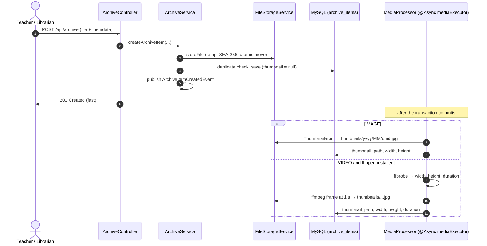

# Phase 4: Archive and Media Processing

> **Status:** Done · **Commit:** `f462eec` · **Roadmap:** [Phase 4](backend-phases.md#phase-4-archive-and-media-processing) · **Spec:** [Archive endpoints](backend-spec.md#32-public-archive)

## 1. Summary

The school archive: photos, documentation videos and official documents.
- **Upload and manage**: media type (`IMAGE`, `VIDEO`, `DOCUMENT`) detected from the file, default `STAFF` visibility, duplicate check, soft delete and restore, ownership rules.
- **Video streaming**: seeking/scrubbing for MP4, WebM and MKV through the shared `RangeFileResponder`.
- **Async media processing**: `MediaProcessor` creates ~400 px thumbnails and reads dimensions and duration, without slowing the upload response.
- **Browse and search**: filter by category, media type and event date range; full-text search on title and description.

**Done when:** an image and an MP4 can be uploaded, thumbnails appear, the video seeks, and STAFF items are hidden from anonymous callers.

---

## 2. Decisions

- **Archive defaults to `STAFF`** (books default to `PUBLIC`). Only items explicitly marked `PUBLIC` are visible to students; anonymous requests for STAFF items return 404.
- **`Visibility` moved to `common`.** Book and archive must not depend on each other, so the shared enum lives in `common/Visibility.java`.
- **`ffmpeg` is optional.** If `ffmpeg`/`ffprobe` are not on the `PATH`, video width/height/duration stay null and the thumbnail endpoint serves an SVG video icon.
- **Dedicated thread pool.** `mediaExecutor` (core 2, max 4, queue 50) keeps CPU-heavy thumbnail work away from request threads.

---

## 3. Design



---

## 4. Changes

### `common` / `config`
| File | Change | Notes |
|---|---|---|
| `common/Visibility.java` | Moved | From `book/`; imports updated in the book classes. |
| `config/AsyncConfig.java` | New | `@EnableAsync`, `mediaExecutor`. |

### `media`
| File | Change | Notes |
|---|---|---|
| `ArchiveItemCreatedEvent.java` | New | `(itemId, storedPath, mediaType, mimeType)`. |
| `MediaProcessor.java` | New | Image thumbnails (Thumbnailator); video probe + poster frame (`ffprobe`, `ffmpeg -ss 00:00:01 -vframes 1`); `ArchiveRepository.updateMediaMetadata(...)`. |

### `archive`
| File | Change | Notes |
|---|---|---|
| `MediaType.java` | New | `image/*` → IMAGE, `video/*` → VIDEO, else DOCUMENT. |
| `ArchiveItem.java` | New | Entity for `archive_items` (event date, visibility, media info, `viewCount`, soft delete). |
| `ArchiveRepository`, `ArchiveSpecifications` | New | Native FULLTEXT search with filters; Specification + `LIKE` fallback; `incrementViewCount`, `updateMediaMetadata`. |
| `ArchiveSummaryDto`, `ArchiveDetailDto`, `ArchiveMetadataRequest`, `UpdateArchiveRequest`, `ArchiveSearchCriteria` | New | API DTOs. |
| `ArchiveService.java` | New | List, get, stream, download, thumbnail (SVG per media type as fallback), create (with compensation + event), update, soft delete, restore, mine. |
| `ArchiveController.java`, `ArchiveAdminController.java` | New | Endpoints below. |

### `storage`
| File | Change | Notes |
|---|---|---|
| `FileTypeDetector.java` | Modified | WebM/MKV detection fix (see §7). |

---

## 5. API

| Method | Path | Access | Result |
|---|---|---|---|
| GET | `/api/archive` | Public | `200` page. Query: `q`, `categoryId`, `mediaType`, `from`, `to`, `sort` |
| GET | `/api/archive/{id}`, `/file`, `/download`, `/thumbnail` | Public (STAFF items: staff only) | `200` / `206` |
| GET | `/api/archive/mine` | Staff | `200` page |
| POST | `/api/archive` | Staff | `201` |
| PUT | `/api/archive/{id}` | Owner or librarian | `200` |
| DELETE | `/api/archive/{id}` | Owner or librarian | `204` |
| POST | `/api/admin/archive/{id}/restore` | Librarian | `200` |

Errors: `FILE_REQUIRED`, `INVALID_FILE_TYPE`, `DUPLICATE_FILE`, `FORBIDDEN`, `NOT_FOUND`. See the [error catalog](backend-spec.md#4-errors).

---

## 6. Testing

### 6.1 Automated
```powershell
./mvnw test-compile
```
Compiles only; no Phase 4 unit tests yet (integration tests are planned for Phase 8).

### 6.2 Manual (Postman)

#### Setup
| Variable | Initial Value | Notes |
|---|---|---|
| `baseUrl` | `http://localhost:8081` | Dev backend server port |
| `adminToken` | *(empty)* | Set by Request 1 |
| `archiveId` | *(empty)* | Set by Request 2 |
| `videoId` | *(empty)* | Set by Request 5 |
| `staffItemId` | *(empty)* | Set by Request 7 |

Have ready: a `.jpg`/`.png` photo, a short `.mp4` (or `.webm`/`.mkv`) video, and a `.pdf`. For video thumbnails, `ffmpeg` must be on the `PATH` the app was started with.

---

#### Request 1: Admin Login
* **Method**: `POST`
* **URL**: `{{baseUrl}}/api/auth/login`
* **Headers**:
  * `Content-Type: application/json`
* **Body** (`raw` - JSON):
  ```json
  {
    "username": "admin",
    "password": "admin123"
  }
  ```
* **Postman Tests Script**:
  ```javascript
  pm.test("Status code is 200", function () {
      pm.response.to.have.status(200);
      pm.environment.set("adminToken", pm.response.json().token);
  });
  ```

---

#### Request 2: Upload Public Image
* **Method**: `POST`
* **URL**: `{{baseUrl}}/api/archive`
* **Headers**:
  * `Authorization: Bearer {{adminToken}}`
* **Body** (`form-data`):
  | Key | Type | Value / File | Content-Type |
  |---|---|---|---|
  | `file` | `File` | *(a `.jpg` or `.png` photo)* | `image/jpeg` |
  | `metadata` | `Text` | `{"title":"Upacara HUT RI ke-81","description":"Dokumentasi upacara bendera 17 Agustus","categoryId":1,"eventDate":"2026-08-17","visibility":"PUBLIC"}` | `application/json` |
* **Postman Tests Script**:
  ```javascript
  pm.test("Status code is 201", function () {
      pm.response.to.have.status(201);
      pm.environment.set("archiveId", pm.response.json().id);
  });
  ```
* **Expected Response** (`201 Created`):
  ```json
  {
    "id": 1,
    "title": "Upacara HUT RI ke-81",
    "mediaType": "IMAGE",
    "visibility": "PUBLIC",
    "originalName": "photo.jpg",
    "mimeType": "image/jpeg"
  }
  ```

---

#### Request 3: Thumbnail and Dimensions Were Extracted
*(Wait 1–2 seconds for `MediaProcessor`.)*
* **Method**: `GET`
* **URL**: `{{baseUrl}}/api/archive/{{archiveId}}`
* **Headers**: *(None)*
* **Expected Response** (`200 OK`): `"mediaType": "IMAGE"`, `thumbnailPath` set (e.g. `thumbnails/2026/11/...jpg`), positive `width` and `height`.

---

#### Request 4: Get Thumbnail
* **Method**: `GET`
* **URL**: `{{baseUrl}}/api/archive/{{archiveId}}/thumbnail`
* **Headers**: *(None)*
* **Expected Response** (`200 OK`): `Content-Type: image/jpeg`. An SVG (`image/svg+xml`) means no thumbnail was generated.

---

#### Request 5: Upload Video
* **Method**: `POST`
* **URL**: `{{baseUrl}}/api/archive`
* **Headers**:
  * `Authorization: Bearer {{adminToken}}`
* **Body** (`form-data`):
  | Key | Type | Value / File | Content-Type |
  |---|---|---|---|
  | `file` | `File` | *(a `.mp4`, `.webm` or `.mkv`)* | `video/mp4` *(or `video/webm` / `video/x-matroska`)* |
  | `metadata` | `Text` | `{"title":"Pentas Seni 2026","description":"Video rekaman pentas seni tahunan","eventDate":"2026-05-10","visibility":"PUBLIC"}` | `application/json` |
* **Postman Tests Script**:
  ```javascript
  pm.test("Status code is 201", function () {
      pm.response.to.have.status(201);
      pm.environment.set("videoId", pm.response.json().id);
  });
  ```
* **Expected Response** (`201 Created`): `"mediaType": "VIDEO"`, `"visibility": "PUBLIC"`. A few seconds later `GET /api/archive/{{videoId}}` shows `width`, `height` and `durationSeconds` (if `ffmpeg` is installed).

---

#### Request 6: Video Seeking (Range)
* **Method**: `GET`
* **URL**: `{{baseUrl}}/api/archive/{{videoId}}/file`
* **Headers**:
  * `Range: bytes=0-1048575` *(first 1 MB)*
* **Expected Response** (`206 Partial Content`): `Content-Range: bytes 0-1048575/<total>`, `Accept-Ranges: bytes`.

---

#### Request 7: Upload Document with Default STAFF Visibility
* **Method**: `POST`
* **URL**: `{{baseUrl}}/api/archive`
* **Headers**:
  * `Authorization: Bearer {{adminToken}}`
* **Body** (`form-data`):
  | Key | Type | Value / File | Content-Type |
  |---|---|---|---|
  | `file` | `File` | *(a `.pdf` or `.docx`)* | `application/pdf` |
  | `metadata` | `Text` | `{"title":"SK Rapat Dewan Guru"}` | `application/json` |
* **Postman Tests Script**:
  ```javascript
  pm.test("Defaults to STAFF", function () {
      pm.response.to.have.status(201);
      pm.expect(pm.response.json().visibility).to.eql("STAFF");
      pm.environment.set("staffItemId", pm.response.json().id);
  });
  ```
* **Expected Response** (`201 Created`): `"mediaType": "DOCUMENT"`, `"visibility": "STAFF"`.

---

#### Request 8: STAFF Item Is Hidden from Anonymous Callers
* **Method**: `GET`
* **URL**: `{{baseUrl}}/api/archive/{{staffItemId}}`
* **Headers**: *(None)*
* **Expected Response** (`404 Not Found`):
  ```json
  {
    "status": 404,
    "code": "NOT_FOUND",
    "message": "Archive item not found with id: 3"
  }
  ```

---

#### Request 9: STAFF Item Is Visible to Staff
* **Method**: `GET`
* **URL**: `{{baseUrl}}/api/archive/{{staffItemId}}`
* **Headers**:
  * `Authorization: Bearer {{adminToken}}`
* **Expected Response** (`200 OK`): full item metadata.

---

#### Request 10: Search with Filters (Anonymous)
* **Method**: `GET`
* **URL**: `{{baseUrl}}/api/archive?q=pentas&mediaType=VIDEO`
* **Headers**: *(None)*
* **Expected Response** (`200 OK`):
  ```json
  {
    "content": [
      { "id": 2, "title": "Pentas Seni 2026", "mediaType": "VIDEO", "visibility": "PUBLIC", "viewCount": 0 }
    ],
    "totalElements": 1,
    "last": true
  }
  ```

---

#### Request 11: Download Archive File
* **Method**: `GET`
* **URL**: `{{baseUrl}}/api/archive/{{videoId}}/download`
* **Headers**: *(None)*
* **Expected Response** (`200 OK`): `Content-Disposition: attachment; filename="..."`. *(Counted asynchronously since Phase 5.)*

---

#### Request 12: List My Uploads
* **Method**: `GET`
* **URL**: `{{baseUrl}}/api/archive/mine`
* **Headers**:
  * `Authorization: Bearer {{adminToken}}`
* **Expected Response** (`200 OK`): paged list of items uploaded by the current user.

---

#### Request 13: Soft Delete
* **Method**: `DELETE`
* **URL**: `{{baseUrl}}/api/archive/{{archiveId}}`
* **Headers**:
  * `Authorization: Bearer {{adminToken}}`
* **Expected Response** (`204 No Content`). Request 3 now returns `404 Not Found`.

---

#### Request 14: Restore (Librarian Only)
* **Method**: `POST`
* **URL**: `{{baseUrl}}/api/admin/archive/{{archiveId}}/restore`
* **Headers**:
  * `Authorization: Bearer {{adminToken}}`
* **Expected Response** (`200 OK`): the restored item. Request 3 succeeds again.

---

## 7. Issues and fixes

| Issue | Cause | Fix |
|---|---|---|
| WebM and MKV uploads rejected with `400 INVALID_FILE_TYPE`. | Both use the EBML container. Tika was called without the file name, so `.webm` was detected as `application/x-matroska`, which was not whitelisted. | `FileTypeDetector` passes the file name to Tika (`RESOURCE_NAME_KEY`); Matroska with a `.webm` extension is normalized to `video/webm`; `.mkv` (`video/x-matroska`) added to the archive whitelist. |
| Race: a thumbnail could silently fail to be saved (null `thumbnailPath`). Found in code review, not reported. | `MediaProcessor` was a plain `@Async @EventListener`, so it could run before the archive row was committed and update nothing. Bulk import made this likely. | Fixed in Phase 6: `@TransactionalEventListener(AFTER_COMMIT)` + `REQUIRES_NEW`. |
