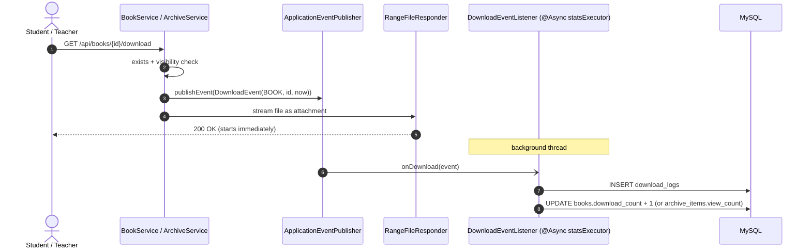

# Phase 5: Download Counters and Admin Stats

> **Status:** Done · **Commit:** `8a78b3f` · **Roadmap:** [Phase 5](backend-phases.md#phase-5-download-counters-and-admin-stats) · **Spec:** [Librarian endpoints](backend-spec.md#36-librarian-only)

## 1. Summary

Download counting that never slows down file streaming, plus a stats endpoint for the librarian.
- **Async counters**: `/download` publishes a `DownloadEvent` and starts streaming immediately; a background listener writes the log row and increments the counter.
- **Download log**: one `download_logs` row per download (`item_type`, `item_id`, `downloaded_at`), no IP stored.
- **Counters**: `books.download_count` and `archive_items.view_count`.
- **Admin stats**: `GET /api/admin/stats` with totals, downloads today / this week, a 7-day trend, counts by type and the top 5 books.

**Done when:** downloads increment counts without slowing streaming.

---

## 2. Decisions

- **No DB write on the streaming path.** Before this phase, `downloadBookFile` / `downloadArchiveFile` ran a synchronous `UPDATE` in the request thread. Now they only publish an event.
- **Separate `statsExecutor`** (core 1, max 2, queue 500) so cheap stats writes never wait behind CPU-heavy thumbnail work on `mediaExecutor`.
- **Failures are logged, not thrown.** A failed stats write must never affect the user's download.
- **Stats pulled forward from Phase 7.** `GET /api/admin/stats` was built now so the counters can be verified end to end.
- **"Today" is Jakarta time** (`Asia/Jakarta`); "this week" is the last 7 days.
- **Only `/download` counts.** Inline viewing (`/file`) and thumbnails are not counted.

---

## 3. Design



---

## 4. Changes

### `config`
| File | Change | Notes |
|---|---|---|
| `AsyncConfig.java` | Modified | Added `statsExecutor`. |

### `stats`
| File | Change | Notes |
|---|---|---|
| `ItemType.java` | New | `BOOK`, `ARCHIVE` (matches `download_logs.item_type`). |
| `DownloadEvent.java` | New | `(itemType, itemId, downloadedAt)`. |
| `DownloadLog.java`, `DownloadLogRepository.java` | New | Entity for `download_logs`; counts since a time, per type; native 7-day daily trend query. |
| `DownloadEventListener.java` | New | `@Async("statsExecutor") @EventListener @Transactional`: insert log, increment counter. |
| `StatsService.java`, `AdminStatsController.java` | New | Builds `AdminStatsDto`; `GET /api/admin/stats` (LIBRARIAN). |
| `dto/AdminStatsDto`, `dto/TopBookDto`, `dto/DailyTrendDto` | New | Response DTOs. |

### `book` / `archive`
| File | Change | Notes |
|---|---|---|
| `BookRepository.java` | Modified | `countByDeletedAtIsNull`, `findTop5ByDeletedAtIsNullOrderByDownloadCountDesc`, `countGroupedByBookType`. |
| `ArchiveRepository.java` | Modified | `countByDeletedAtIsNull`, `countGroupedByMediaType`. |
| `BookService.java`, `ArchiveService.java` | Modified | Download methods publish `DownloadEvent` instead of updating synchronously. |

---

## 5. API

| Method | Path | Access | Result |
|---|---|---|---|
| GET | `/api/admin/stats` | Librarian | `200` `AdminStatsDto` |
| GET | `/api/books/{id}/download`, `/api/archive/{id}/download` | Public | Unchanged response; now counted asynchronously. |

`AdminStatsDto` fields: `totalBooks`, `totalArchiveItems`, `totalDownloads`, `downloadsToday`, `downloadsThisWeek`, `booksByType`, `archiveByMediaType`, `topBooks[] {id, title, author, downloadCount}`, `dailyDownloads[] {date, count}`.

---

## 6. Testing

### 6.1 Automated
None specific to this phase yet (integration tests are planned for Phase 8).

### 6.2 Manual (Postman)

#### Setup
| Variable | Initial Value | Notes |
|---|---|---|
| `baseUrl` | `http://localhost:8081` | Dev backend server port |
| `adminToken` | *(empty)* | Set by Request 1 |
| `bookId` | `1` | An existing, active book (Phase 3) |
| `archiveId` | `1` | An existing, active PUBLIC archive item (Phase 4) |

---

#### Request 1: Admin Login
* **Method**: `POST`
* **URL**: `{{baseUrl}}/api/auth/login`
* **Headers**:
  * `Content-Type: application/json`
* **Body** (`raw` - JSON):
  ```json
  {
    "username": "admin",
    "password": "admin123"
  }
  ```
* **Postman Tests Script**:
  ```javascript
  pm.test("Status code is 200", function () {
      pm.response.to.have.status(200);
      pm.environment.set("adminToken", pm.response.json().token);
  });
  ```

---

#### Request 2: Stats Before Downloads
* **Method**: `GET`
* **URL**: `{{baseUrl}}/api/admin/stats`
* **Headers**:
  * `Authorization: Bearer {{adminToken}}`
* **Postman Tests Script** (remember the baseline):
  ```javascript
  pm.test("Status code is 200", function () {
      pm.response.to.have.status(200);
      pm.environment.set("downloadsBefore", pm.response.json().totalDownloads);
  });
  ```
* **Expected Response** (`200 OK`), e.g. on a fresh database:
  ```json
  {
    "totalBooks": 1,
    "totalArchiveItems": 2,
    "totalDownloads": 0,
    "downloadsToday": 0,
    "downloadsThisWeek": 0,
    "booksByType": { "EBOOK": 1 },
    "archiveByMediaType": { "IMAGE": 1, "VIDEO": 1 },
    "topBooks": [],
    "dailyDownloads": []
  }
  ```

---

#### Request 3: Download a Book
* **Method**: `GET`
* **URL**: `{{baseUrl}}/api/books/{{bookId}}/download`
* **Headers**: *(None)*
* **Expected Response** (`200 OK`): `Content-Disposition: attachment; filename="..."`; the file streams immediately.

---

#### Request 4: Download an Archive Item
* **Method**: `GET`
* **URL**: `{{baseUrl}}/api/archive/{{archiveId}}/download`
* **Headers**: *(None for PUBLIC items)*
* **Expected Response** (`200 OK`): `Content-Disposition: attachment; filename="..."`.

---

#### Request 5: Stats After Downloads
*(Wait about half a second for the background thread.)*
* **Method**: `GET`
* **URL**: `{{baseUrl}}/api/admin/stats`
* **Headers**:
  * `Authorization: Bearer {{adminToken}}`
* **Postman Tests Script**:
  ```javascript
  pm.test("Two downloads were counted", function () {
      var stats = pm.response.json();
      var before = Number(pm.environment.get("downloadsBefore"));
      pm.expect(stats.totalDownloads).to.eql(before + 2);
  });
  ```
* **Expected Response** (`200 OK`): `totalDownloads`, `downloadsToday` and `downloadsThisWeek` each +2; `topBooks` contains the book with a positive `downloadCount`; `dailyDownloads` has an entry for today.

---

#### Request 6: Non-Librarian Is Blocked
* **Method**: `GET`
* **URL**: `{{baseUrl}}/api/admin/stats`
* **Headers**: *(None, or a teacher token)*
* **Expected Response**: `401 Unauthorized` without a token, `403 Forbidden` with a teacher token:
  ```json
  {
    "status": 401,
    "code": "UNAUTHORIZED",
    "message": "Full authentication is required to access this resource"
  }
  ```

---

## 7. Issues and fixes

None.
