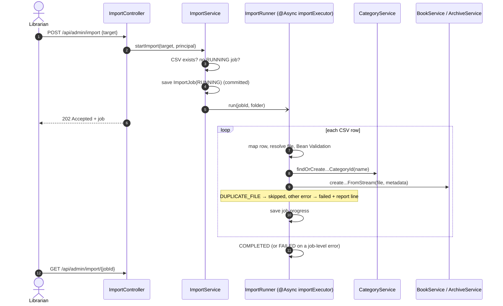

# Phase 6: Bulk Import

> **Status:** Done · **Commit:** `e50862f` · **Roadmap:** [Phase 6](backend-phases.md#phase-6-bulk-import) · **Spec:** [Bulk import rules](backend-spec.md#55-bulk-import)

## 1. Summary

Lets a librarian load an existing collection (folders of PDFs, photos, videos) in one go instead of uploading files one at a time.
- **Folder + CSV**: copy files plus a CSV into the import folder, then call `POST /api/admin/import`.
- **Same path as a normal upload**: every row goes through the book/archive create logic, so file checks, the free-space guard, duplicate detection, cleanup on failure and thumbnails behave exactly like a manual upload.
- **One job at a time** on a single-thread executor.
- **Per-row report**: duplicates are `skipped`, bad rows are `failed` with a readable line; a bad row never stops the job.
- **Live progress**: `GET /api/admin/import/{jobId}`.

**Done when:** a folder of files plus a CSV imports correctly, duplicates are skipped, and bad rows are reported without stopping the job.

---

## 2. Decisions

- **Unknown category names are auto-created** (top-level).
- **Source files are left in place.** Re-running an import is safe because already-imported files are skipped as duplicates.
- **Imported items have no uploader** (`uploaded_by = NULL`, per the schema), so only librarians can edit them.
- **A blank title** falls back to the file name without its extension.
- **No transaction around the loop.** Each row commits on its own, so one failure never rolls back the others.
- **A job can never stay RUNNING forever.** Any job-level failure (including Java `Error`s such as a missing library) marks it `FAILED` with the reason. Jobs left `RUNNING` by a restart are marked `FAILED` at startup.
- **Duplicate check includes soft-deleted items.** The DB unique key on `checksum_sha256` covers trashed rows, so the check must too (applies to normal uploads as well).

### Folder and CSV convention
```
{import-dir}/books/books.csv       + the book files in {import-dir}/books/
{import-dir}/archive/archive.csv   + the archive files in {import-dir}/archive/
```
`import-dir` is `./data/import` in dev (relative to the folder the app starts from) and `/mnt/library/import` in prod.

| Target | Columns (only `filename` is required) |
|---|---|
| BOOK | `filename,title,author,publisher,year,type,category,grade,curriculum,visibility` |
| ARCHIVE | `filename,title,description,category,eventDate,visibility` |

- Header row required; column names case-insensitive, any order.
- UTF-8; a BOM (added by Excel) is stripped. Delimiter auto-detected: `,` or `;` (Excel with an Indonesian locale saves `;`).
- Quoted fields may contain commas and line breaks.
- Enum values are case-insensitive; spaces/dashes become `_` (`teaching module` = `TEACHING_MODULE`). Defaults as in the [spec](backend-spec.md#51-visibility-and-defaults).
- `year` = 4 digits; `eventDate` = `YYYY-MM-DD`.
- `filename` may include a subfolder (`kelas-x/fisika.pdf`) but must stay inside the target folder (`..` and absolute paths are rejected).

---

## 3. Design



`ImportRunner` is a separate bean from `ImportService` so the `@Async` call goes through the Spring proxy. `ImportService.startImport` is deliberately not transactional: the job row must be committed before the runner reads it.

---

## 4. Changes

### `importer` (new package)
| File | Change | Notes |
|---|---|---|
| `ImportTarget`, `ImportStatus` | New | `BOOK`/`ARCHIVE` (+ subfolder and CSV name); `RUNNING`/`COMPLETED`/`FAILED`. |
| `ImportJob`, `ImportJobRepository` | New | Entity for the existing `import_jobs` table. |
| `StartImportRequest`, `ImportJobDto` | New | API in/out; `errors` = error report split into lines. |
| `ImportCsvReader` | New | Pure CSV reader (Commons CSV): BOM, delimiter detection, header check. |
| `ImportRowMapper`, `ImportRowException` | New | Pure: CSV row → `BookMetadataRequest` / `ArchiveMetadataRequest` with readable errors. |
| `ImportRunner` | New | `@Async("importExecutor")` job loop; error report capped at 1000 lines. |
| `ImportService` | New | Start (checks, single-job guard), get, list; fails interrupted jobs at startup. |
| `ImportController` | New | `/api/admin/import` endpoints, LIBRARIAN only. |

### Other packages
| File | Change | Notes |
|---|---|---|
| `pom.xml` | Modified | `org.apache.commons:commons-csv` 1.14.1. |
| `config/AsyncConfig.java` | Modified | `importExecutor` (core 1, max 1, queue 5). |
| `book/BookService.java`, `archive/ArchiveService.java` | Modified | Create logic split so multipart uploads and the new `createBookFromStream` / `createArchiveItemFromStream` share store → duplicate check → save → compensation. |
| `book/BookRepository.java`, `archive/ArchiveRepository.java` | Modified | `existsByChecksumSha256` (includes soft-deleted rows). |
| `category/CategoryService.java` | Modified | `findOrCreateBookCategoryId`, `findOrCreateArchiveCategoryId`. |
| `media/MediaProcessor.java` | Modified | `@TransactionalEventListener(AFTER_COMMIT)` + `REQUIRES_NEW` (thumbnail race fix, see [Phase 4](phase-4-archive.md#7-issues-and-fixes)). |

---

## 5. API

| Method | Path | Access | Result |
|---|---|---|---|
| POST | `/api/admin/import` | Librarian | Body `{"target":"BOOK"}` or `{"target":"ARCHIVE"}` → `202 Accepted` + job, `Location` header |
| GET | `/api/admin/import/{jobId}` | Librarian | `200` job progress and errors |
| GET | `/api/admin/import` | Librarian | `200` 20 most recent jobs |

Errors: `400 IMPORT_CSV_NOT_FOUND`, `400 IMPORT_DIR_NOT_CONFIGURED`, `409 IMPORT_ALREADY_RUNNING`, `503 IMPORT_QUEUE_FULL`, `404 NOT_FOUND`, `401`/`403`.

Example job:
```json
{
  "id": 3,
  "target": "BOOK",
  "status": "COMPLETED",
  "totalRows": 5,
  "succeeded": 2,
  "skipped": 1,
  "failed": 2,
  "errors": [
    "Row 5 (hilang.pdf): File not found in the import folder",
    "Row 6 (sejarah.pdf): Invalid grade 'XIII' (allowed: X, XI, XII, ALL)"
  ],
  "startedBy": 1,
  "startedAt": "2026-11-19T07:00:00Z",
  "finishedAt": "2026-11-19T07:00:04Z"
}
```

---

## 6. Testing

### 6.1 Automated
```powershell
./mvnw test -Dtest="Import*Test"
```
| Test | Covers |
|---|---|
| `ImportCsvReaderTest` | Comma and semicolon files, BOM, quoted commas, blank/delimiter-only lines, short rows, missing header column, empty file. |
| `ImportRowMapperTest` | Case-insensitive enums, defaults for blank cells, bad year/date/grade messages, missing filename, path traversal (`../`). |

### 6.2 Manual (Postman)

> **Result:** Requests 1–10 tested manually and passing. Requests 11–14 (missing CSV, concurrent import, role guard, soft-deleted duplicate) not yet run manually.

#### Setup
Restart the app after pulling this phase (new library in `pom.xml`). In Eclipse run **Maven → Update Project** first, or start with `.\mvnw.cmd spring-boot:run`.

**Ready-made archive data**: `seed/import/archive/` (20 items + `archive.csv`) can be copied to `./data/import/archive/` and imported as-is. See the [README](../README.md#2-getting-started-dev).

**Book test data**: create `./data/import/books/` with:
- `fisika-x.pdf`, `modul-kimia.pdf`: two PDFs not yet in the library.
- `copy.pdf`: a copy of a PDF already uploaded (Phase 3).
- `sejarah.pdf`: any PDF.
- `books.csv`:
  ```csv
  filename,title,author,publisher,year,type,category,grade,curriculum,visibility
  fisika-x.pdf,"Fisika, Jilid 1",Budi Santoso,Erlangga,2023,EBOOK,Fisika,X,Merdeka,PUBLIC
  modul-kimia.pdf,Modul Kimia Dasar,,,2024,teaching module,Seni Budaya,XI,Merdeka,STAFF
  copy.pdf,Duplicate Book,,,,,,,,
  hilang.pdf,Missing File,,,,,,,,
  sejarah.pdf,Sejarah Indonesia,,,,,Sejarah,XIII,,
  ```

**Archive test data**: create `./data/import/archive/` with `upacara.jpg`, `pentas.mp4`, `piala-lomba.png` and:
- `archive.csv`:
  ```csv
  filename,title,description,category,eventDate,visibility
  upacara.jpg,Upacara 17 Agustus,"Upacara bendera di lapangan, diikuti seluruh siswa",Kegiatan Sekolah,2026-08-17,PUBLIC
  pentas.mp4,Pentas Seni 2026,Video pentas seni akhir tahun,Kegiatan Sekolah,2026-10-28,
  piala-lomba.png,Juara Lomba Sains,,Prestasi Siswa,2026-09-05,PUBLIC
  ```
  *(Test media can be generated with ffmpeg, e.g. `ffmpeg -f lavfi -i testsrc=size=640x360:rate=25 -t 8 -pix_fmt yuv420p pentas.mp4`.)*

| Variable | Initial Value | Notes |
|---|---|---|
| `baseUrl` | `http://localhost:8081` | Dev backend server port |
| `adminToken` | *(empty)* | Set by Request 1 |
| `teacherToken` | *(empty)* | A TEACHER token (Phase 1, Request 4) |
| `jobId` | *(empty)* | Set by Requests 2 and 7 |
| `archiveId` | *(empty)* | Set by Request 8 |

---

#### Request 1: Admin Login
* **Method**: `POST`
* **URL**: `{{baseUrl}}/api/auth/login`
* **Headers**:
  * `Content-Type: application/json`
* **Body** (`raw` - JSON):
  ```json
  {
    "username": "admin",
    "password": "admin123"
  }
  ```
* **Postman Tests Script**:
  ```javascript
  pm.test("Status code is 200", function () {
      pm.response.to.have.status(200);
      pm.environment.set("adminToken", pm.response.json().token);
  });
  ```

---

#### Request 2: Start Book Import
* **Method**: `POST`
* **URL**: `{{baseUrl}}/api/admin/import`
* **Headers**:
  * `Content-Type: application/json`
  * `Authorization: Bearer {{adminToken}}`
* **Body** (`raw` - JSON):
  ```json
  {
    "target": "BOOK"
  }
  ```
* **Postman Tests Script**:
  ```javascript
  pm.test("Status code is 202", function () {
      pm.response.to.have.status(202);
      pm.environment.set("jobId", pm.response.json().id);
  });
  ```
* **Expected Response** (`202 Accepted`, header `Location: /api/admin/import/<id>`):
  ```json
  {
    "id": 1,
    "target": "BOOK",
    "status": "RUNNING",
    "totalRows": 0,
    "succeeded": 0,
    "skipped": 0,
    "failed": 0,
    "errors": [],
    "startedBy": 1,
    "startedAt": "2026-11-19T07:00:00Z",
    "finishedAt": null
  }
  ```

---

#### Request 3: Check Job Progress
*(Send again after a second or two until `status` is no longer `RUNNING`.)*
* **Method**: `GET`
* **URL**: `{{baseUrl}}/api/admin/import/{{jobId}}`
* **Headers**:
  * `Authorization: Bearer {{adminToken}}`
* **Postman Tests Script**:
  ```javascript
  pm.test("Job finished with expected counts", function () {
      var job = pm.response.json();
      pm.expect(job.status).to.eql("COMPLETED");
      pm.expect(job.totalRows).to.eql(5);
      pm.expect(job.succeeded).to.eql(2);
      pm.expect(job.skipped).to.eql(1);
      pm.expect(job.failed).to.eql(2);
  });
  ```
* **Expected Response** (`200 OK`): `COMPLETED`, `totalRows 5`, `succeeded 2`, `skipped 1`, `failed 2`, with errors:
  ```json
  [
    "Row 5 (hilang.pdf): File not found in the import folder",
    "Row 6 (sejarah.pdf): Invalid grade 'XIII' (allowed: X, XI, XII, ALL)"
  ]
  ```

---

#### Request 4: Imported Books Are Searchable
* **Method**: `GET`
* **URL**: `{{baseUrl}}/api/books?q=fisika`
* **Headers**: *(None)*
* **Expected Response** (`200 OK`): `content` contains `"title": "Fisika, Jilid 1"`. *(`Modul Kimia Dasar` is STAFF; it appears only with `Authorization: Bearer {{adminToken}}`.)*

---

#### Request 5: Category Was Auto-Created
* **Method**: `GET`
* **URL**: `{{baseUrl}}/api/categories?type=BOOK`
* **Headers**: *(None)*
* **Expected Response** (`200 OK`): the list contains `"Seni Budaya"`.

---

#### Request 6: Re-run the Same Import
* **Method**: `POST`
* **URL**: `{{baseUrl}}/api/admin/import`
* **Headers & Body**: identical to Request 2.
* **Expected Result**: then send Request 3. The job shows `"succeeded": 0, "skipped": 3, "failed": 2`; nothing was imported twice.

---

#### Request 7: Start Archive Import
* **Method**: `POST`
* **URL**: `{{baseUrl}}/api/admin/import`
* **Headers**:
  * `Content-Type: application/json`
  * `Authorization: Bearer {{adminToken}}`
* **Body** (`raw` - JSON):
  ```json
  {
    "target": "ARCHIVE"
  }
  ```
* **Postman Tests Script**:
  ```javascript
  pm.test("Status code is 202", function () {
      pm.response.to.have.status(202);
      pm.environment.set("jobId", pm.response.json().id);
  });
  ```
* **Expected Result**: then send Request 3: `"target": "ARCHIVE"`, `"status": "COMPLETED"`, `"succeeded": 3`.

---

#### Request 8: Archive Items Use Default Visibility
* **Method**: `GET`
* **URL**: `{{baseUrl}}/api/archive?q=pentas`
* **Headers**:
  * `Authorization: Bearer {{adminToken}}`
* **Postman Tests Script**:
  ```javascript
  pm.test("Pentas Seni was imported as STAFF", function () {
      var item = pm.response.json().content[0];
      pm.expect(item.visibility).to.eql("STAFF");
      pm.environment.set("archiveId", item.id);
  });
  ```
* **Expected Response** (`200 OK`): `Pentas Seni 2026` with `"visibility": "STAFF"`. Without the `Authorization` header: no results.

---

#### Request 9: Thumbnail Was Generated
*(Wait a few seconds after Request 7; the video needs `ffmpeg` on the app's `PATH`.)*
* **Method**: `GET`
* **URL**: `{{baseUrl}}/api/archive/{{archiveId}}/thumbnail`
* **Headers**:
  * `Authorization: Bearer {{adminToken}}`
* **Expected Response** (`200 OK`): `Content-Type: image/jpeg`. An SVG (`image/svg+xml`) means no thumbnail was generated.

---

#### Request 10: List Recent Jobs
* **Method**: `GET`
* **URL**: `{{baseUrl}}/api/admin/import`
* **Headers**:
  * `Authorization: Bearer {{adminToken}}`
* **Expected Response** (`200 OK`): the jobs from Requests 2, 6 and 7, newest first.

---

#### Request 11: Import Without a CSV
*(Temporarily rename `./data/import/books/books.csv` to `books.bak`; rename it back afterwards.)*
* **Method**: `POST`
* **URL**: `{{baseUrl}}/api/admin/import`
* **Headers & Body**: identical to Request 2.
* **Expected Response** (`400 Bad Request`):
  ```json
  {
    "status": 400,
    "code": "IMPORT_CSV_NOT_FOUND",
    "message": "Put the files and 'books.csv' in the 'books' folder of the import directory first"
  }
  ```

---

#### Request 12: Second Import While One Is Running
*(Send Request 2 and then immediately this one. A small CSV may finish first; use many large files to reproduce reliably.)*
* **Method**: `POST`
* **URL**: `{{baseUrl}}/api/admin/import`
* **Headers & Body**: identical to Request 2.
* **Expected Response** (`409 Conflict`):
  ```json
  {
    "status": 409,
    "code": "IMPORT_ALREADY_RUNNING",
    "message": "Another import is still running. Wait for it to finish."
  }
  ```

---

#### Request 13: Non-Librarian Is Blocked
* **Method**: `POST`
* **URL**: `{{baseUrl}}/api/admin/import`
* **Headers**:
  * `Content-Type: application/json`
  * `Authorization: Bearer {{teacherToken}}` *(or no Authorization header)*
* **Body** (`raw` - JSON): `{"target": "BOOK"}`
* **Expected Response**: `403 Forbidden` with a teacher token, `401 Unauthorized` without a token.

---

#### Request 14: Duplicate of a Soft-Deleted Book Returns 409
*(First soft-delete a book: `DELETE {{baseUrl}}/api/books/{id}`.)*
* **Method**: `POST`
* **URL**: `{{baseUrl}}/api/books`
* **Headers**:
  * `Authorization: Bearer {{adminToken}}`
* **Body** (`form-data`): `file` = the deleted book's PDF, `metadata` = `{"title":"Re-upload"}` (`application/json`).
* **Expected Response** (`409 Conflict`):
  ```json
  {
    "status": 409,
    "code": "DUPLICATE_FILE",
    "message": "A book with the same file content already exists (it may be in the trash)"
  }
  ```

---

## 7. Issues and fixes

| Issue | Cause | Fix |
|---|---|---|
| First import stayed `RUNNING` forever with `totalRows 0`. | The Eclipse run configuration had a stale classpath without `commons-codec` (a dependency of Commons CSV), so the runner died with `NoClassDefFoundError`. That is an `Error`, and the runner only caught `Exception`. | Runner now catches `Throwable` and marks the job `FAILED` with the reason. Environment fix: Maven → Update Project (force update) and restart. |
