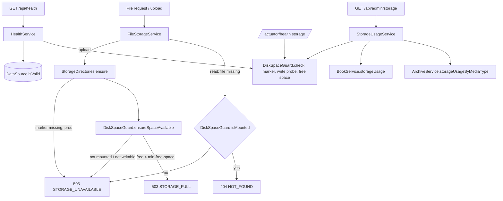

# Phase 7: Storage Usage and Health

> **Status:** Done · **Commit:** `652bbdf` · **Roadmap:** [Phase 7](backend-phases.md#phase-7-storage-usage-and-health) · **Spec:** [Operations](backend-spec.md#7-operations)

## 1. Summary

Keeps the library usable when the external drive is unplugged or full, and tells the librarian how the space is used.
- **Mount detection**: the storage root must contain a `.library-storage` marker file. Without it the drive counts as not mounted.
- **Degraded mode**: with the drive gone, browsing and search keep working (they only need MySQL); file requests return `503 STORAGE_UNAVAILABLE`; covers and thumbnails fall back to SVG placeholders.
- **Public health**: `GET /api/health` → `UP`, `DEGRADED` or `DOWN`.
- **Actuator**: a `storage` component in `/actuator/health`.
- **Storage report**: `GET /api/admin/storage` (librarian): disk total/used/free plus a breakdown of books, archive images/videos/documents, the trash, thumbnails and temp files.

**Done when:** unplugging the drive in testing makes file requests return 503 while browsing keeps working.

---

## 2. Decisions

- **Marker file, not "the folder exists".** On Linux an unmounted `/mnt/library/files` is still an empty folder on the OS disk. Before this phase, `StorageDirectories.ensure()` ran before every upload and would recreate the sub-folders there, so uploads would silently fill the OS disk. Now storage is available only when the root holds `.library-storage`.
- **Prod never creates the root or the marker** (`app.storage.auto-create-root: false`, the default). The marker is created once by hand during server setup. Dev sets `auto-create-root: true`, so a fresh checkout works without setup.
- **Startup never fails on storage.** If the drive is missing at boot, the app logs a warning and starts in degraded mode. It recovers without a restart once the drive and marker are back (checks run per request).
- **503 vs 404.** A missing file is `404` only while the drive is mounted. If the drive is gone, `loadAsResource` returns `503 STORAGE_UNAVAILABLE`. The extra check runs only on the "file not found" path, so normal streaming costs nothing extra.
- **`STORAGE_FULL` means only "full".** A missing root used to be reported as `STORAGE_FULL`; it is now `STORAGE_UNAVAILABLE`.
- **`/api/health` returns 200 when DEGRADED.** The app is still serving browsing; only `DOWN` (database unreachable) returns 503.
- **Public vs admin data.** `/api/health` is public, so it shows states only. Byte counts are on the librarian-only `/api/admin/storage`.
- **Report sources.** Book and archive sizes come from the DB (`file_size`), through `BookService` / `ArchiveService` per the dependency rules. Thumbnails and temp files have no size column, so those two folders are measured on disk. Book covers have no size column either and are not counted separately (known gap; they are small).

---

## 3. Design



`/api/health` status: `DOWN` if the database is unreachable; otherwise `DEGRADED` if storage is `UNAVAILABLE` or `LOW_SPACE`; otherwise `UP`.

---

## 4. Changes

### `config` / resources
| File | Change | Notes |
|---|---|---|
| `config/StorageProperties.java` | Modified | `autoCreateRoot` (default `false`). |
| `application-dev.yml` | Modified | `app.storage.auto-create-root: true`. |

### `storage`
| File | Change | Notes |
|---|---|---|
| `StorageStatus.java` | New | `(mounted, writable, totalBytes, usableBytes, minFreeBytes)`, `available()`, `lowSpace()`. |
| `StorageDirectories.java` | Modified | `MARKER`; creates root + marker only with `auto-create-root`; startup logs a warning instead of failing. |
| `DiskSpaceGuard.java` | Modified | `check()`, `isMounted()`, `ensureMounted()`; `ensureSpaceAvailable()` now throws `STORAGE_UNAVAILABLE` for a missing drive. |
| `FileStorageService.java` | Modified | `loadAsResource` and `deleteStoredFile` return 503 when the drive is gone. |

### `common` / `book` / `archive`
| File | Change | Notes |
|---|---|---|
| `common/StorageUsage.java` | New | `(count, bytes, trashCount, trashBytes)`. |
| `book/BookRepository.java`, `book/BookService.java` | Modified | `sumActiveFileSize`, `sumDeletedFileSize`; `storageUsage()`. |
| `archive/ArchiveRepository.java`, `archive/ArchiveService.java` | Modified | Size sums grouped by media type; `storageUsageByMediaType()`. |

### `health` (new package)
| File | Change | Notes |
|---|---|---|
| `HealthService.java`, `HealthController.java`, `HealthDto.java` | New | `GET /api/health`. |
| `StorageHealthIndicator.java` | New | Actuator `storage` component: `UP`, `OUT_OF_SERVICE` (low space), `DOWN` (unavailable). |
| `StorageUsageService.java`, `AdminStorageController.java`, `StorageUsageDto.java` | New | `GET /api/admin/storage`. |

---

## 5. API

| Method | Path | Access | Result |
|---|---|---|---|
| GET | `/api/health` | Public | `200` UP / DEGRADED, `503` DOWN |
| GET | `/api/admin/storage` | Librarian | `200` `StorageUsageDto` |
| GET | `/actuator/health` | Public | Now includes a `storage` component (details in dev only) |

`StorageUsageDto` fields: `available`, `totalBytes`, `usedBytes`, `freeBytes`, `minFreeBytes`, `books {count, bytes, trashCount, trashBytes}`, `archive {IMAGE|VIDEO|DOCUMENT: {count, bytes, trashCount, trashBytes}}`, `thumbnailsBytes`, `tempBytes`. Disk fields are `null` when the drive is not mounted.

Errors: new `503 STORAGE_UNAVAILABLE` on file, upload and import requests while the drive is gone. See the [error catalog](backend-spec.md#4-errors).

---

## 6. Testing

### 6.1 Automated
```powershell
./mvnw test -Dtest="DiskSpaceGuardTest,StorageDirectoriesTest,FileStorageServiceTest,RangeFileResponderTest,HealthServiceTest,Import*Test"
```
| Test | Covers |
|---|---|
| `DiskSpaceGuardTest` | Marker required; missing root → `STORAGE_UNAVAILABLE` (not `STORAGE_FULL`); low space → `STORAGE_FULL`; status values. |
| `StorageDirectoriesTest` | `auto-create-root` creates root + marker; without it an unmarked or missing root throws and nothing is created; startup doesn't fail. |
| `FileStorageServiceTest` | Missing file + missing marker → `503`; upload to an unmounted mount point creates nothing. |
| `HealthServiceTest` | UP / DEGRADED (unplugged, low space) / DOWN (database). |

### 6.2 Manual (Postman)

> **Result:** Requests 1–11 tested manually and passing.

#### Setup
| Variable | Initial Value | Notes |
|---|---|---|
| `baseUrl` | `http://localhost:8081` | Dev backend server port |
| `adminToken` | *(empty)* | Set by Request 1 |
| `teacherToken` | *(empty)* | A TEACHER token (Phase 1, Request 4) |
| `bookId` | `1` | An existing, active PUBLIC book |

After the first start with this phase, `./data/storage/.library-storage` exists (dev creates it).

---

#### Request 1: Admin Login
* **Method**: `POST`
* **URL**: `{{baseUrl}}/api/auth/login`
* **Headers**:
  * `Content-Type: application/json`
* **Body** (`raw` - JSON):
  ```json
  {
    "username": "admin",
    "password": "admin123"
  }
  ```
* **Postman Tests Script**:
  ```javascript
  pm.test("Status code is 200", function () {
      pm.response.to.have.status(200);
      pm.environment.set("adminToken", pm.response.json().token);
  });
  ```

---

#### Request 2: Health Is UP
* **Method**: `GET`
* **URL**: `{{baseUrl}}/api/health`
* **Headers**: *(None)*
* **Expected Response** (`200 OK`):
  ```json
  { "status": "UP", "database": "UP", "storage": "UP" }
  ```

---

#### Request 3: Actuator Shows the Storage Component
* **Method**: `GET`
* **URL**: `{{baseUrl}}/actuator/health`
* **Headers**: *(None)*
* **Expected Response** (`200 OK`): `components.storage` with `"status": "UP"` and details `mounted`, `writable`, `freeBytes`, `minFreeBytes`.

---

#### Request 4: Storage Report
* **Method**: `GET`
* **URL**: `{{baseUrl}}/api/admin/storage`
* **Headers**:
  * `Authorization: Bearer {{adminToken}}`
* **Expected Response** (`200 OK`), e.g.:
  ```json
  {
    "available": true,
    "totalBytes": 511101108224,
    "usedBytes": 302000000000,
    "freeBytes": 209101108224,
    "minFreeBytes": 5368709120,
    "books": { "count": 3, "bytes": 2400000, "trashCount": 0, "trashBytes": 0 },
    "archive": {
      "IMAGE": { "count": 2, "bytes": 800000, "trashCount": 0, "trashBytes": 0 },
      "VIDEO": { "count": 1, "bytes": 1500000, "trashCount": 0, "trashBytes": 0 },
      "DOCUMENT": { "count": 1, "bytes": 30000, "trashCount": 0, "trashBytes": 0 }
    },
    "thumbnailsBytes": 90000,
    "tempBytes": 0
  }
  ```

---

#### Request 5: Non-Librarian Is Blocked
* **Method**: `GET`
* **URL**: `{{baseUrl}}/api/admin/storage`
* **Headers**:
  * `Authorization: Bearer {{teacherToken}}` *(or no Authorization header)*
* **Expected Response**: `403 Forbidden` with a teacher token, `401 Unauthorized` without a token.

---

#### Simulate an unplugged drive
Stop the app. Rename `./data/storage` to `./data/storage-off`. In `application-dev.yml` set `app.storage.auto-create-root: false` (otherwise dev would just recreate the folder). Start the app so the config is rebuilt (`.\mvnw.cmd spring-boot:run`, or in Eclipse Project → Clean first): it starts, and the log shows *"File storage is not available … Starting in degraded mode"*. If that line is missing, the app loaded a stale `target/classes/application-dev.yml` and will recreate `./data/storage`.

#### Request 6: Health Is DEGRADED
* **Method**: `GET`
* **URL**: `{{baseUrl}}/api/health`
* **Headers**: *(None)*
* **Expected Response** (`200 OK`):
  ```json
  { "status": "DEGRADED", "database": "UP", "storage": "UNAVAILABLE" }
  ```

---

#### Request 7: Browsing Still Works
* **Method**: `GET`
* **URL**: `{{baseUrl}}/api/books`
* **Headers**: *(None)*
* **Expected Response** (`200 OK`): the usual paged list.

---

#### Request 8: File Request Returns 503
* **Method**: `GET`
* **URL**: `{{baseUrl}}/api/books/{{bookId}}/file`
* **Headers**: *(None)*
* **Expected Response** (`503 Service Unavailable`):
  ```json
  {
    "status": 503,
    "code": "STORAGE_UNAVAILABLE",
    "message": "File storage is not available right now"
  }
  ```
  *(`/cover` returns the SVG placeholder instead of an error.)*

---

#### Request 9: Upload Returns 503 and Creates Nothing
* **Method**: `POST`
* **URL**: `{{baseUrl}}/api/books`
* **Headers**:
  * `Authorization: Bearer {{adminToken}}`
* **Body** (`form-data`): `file` = any PDF, `metadata` = `{"title":"Offline Upload"}` (`application/json`).
* **Expected Response** (`503 Service Unavailable`): `"code": "STORAGE_UNAVAILABLE"`. No new `./data/storage` folder appears.

---

#### Request 10: Storage Report While Unplugged
* **Method**: `GET`
* **URL**: `{{baseUrl}}/api/admin/storage`
* **Headers**:
  * `Authorization: Bearer {{adminToken}}`
* **Expected Response** (`200 OK`): `"available": false`, disk fields `null`, `books` and `archive` still filled from the database.

---

#### Request 11: Recovery Without a Restart
Rename `./data/storage-off` back to `./data/storage` (the marker is inside). Then repeat Requests 6 and 8.
* **Expected Response**: `/api/health` is `UP` again and the file streams (`200`). Afterwards, set `auto-create-root` back to `true`.

---

## 7. Issues and fixes

| Issue | Cause | Fix |
|---|---|---|
| During manual testing, `./data/storage` was recreated despite `auto-create-root: false`. | Eclipse had not rebuilt, so the app loaded the old `target/classes/application-dev.yml` (still `true`). Not a code bug. | Rebuild before testing (see the setup note above Request 6). |
| With the drive unplugged, file requests returned `404` and uploads could be written to the OS disk. Found in planning, not reported. | `loadAsResource` treated every missing file as 404; `StorageDirectories.ensure()` recreated the root before every upload. | Marker file + `auto-create-root`; `503 STORAGE_UNAVAILABLE`. |
