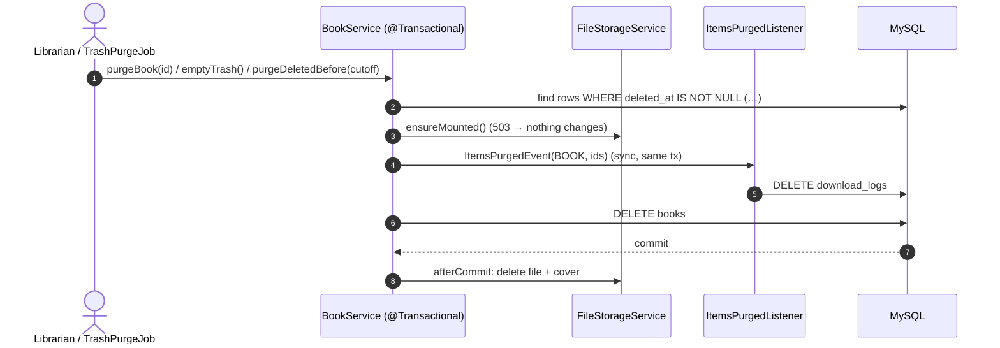

# Phase 9: Trash

> **Status:** Done · **Commit:** _(fill in after commit)_ · **Roadmap:** [Phase 9](backend-phases.md#phase-9-trash) · **Spec:** [§3.6 Librarian only](backend-spec.md#36-librarian-only), [§5.6 Soft delete](backend-spec.md#56-soft-delete)

## 1. Summary

Before this phase, deleted items could only be restored by ID, and their files stayed on disk forever. The front-end's Tempat Sampah screen ([Stage 5A](../frontend%20.md/stage-5a-admin-content.md)) needs a real trash.
- **Trash lists**: `GET /api/admin/{books|archive}/trash`, most recently deleted first, with the uploader and the automatic purge date.
- **Permanent delete**: one item (`DELETE …/trash/{id}`) or the whole trash (`DELETE …/trash` → `{"purged": n}`). Removes the row, its files and its download logs.
- **Nightly purge**: `TrashPurgeJob` deletes items trashed longer than `app.trash.retention` (30 days). It can be turned off.

> This phase was first built on another machine and never pushed. It was rebuilt from the front-end contract in `frontend .md/stage-5a-admin-content.md` and `src/api/admin.js` / `SampahView.vue`, so the field names match what the front-end already uses.

**Done when:** a librarian can list, restore and purge trashed items, a purged file can be uploaded again, and items older than the retention disappear overnight.

---

## 2. Decisions

- **The trash endpoints stay in the feature admin controllers** (`BookAdminController`, `ArchiveAdminController`), next to restore. Books and archive keep separate trashes, matching the front-end tabs, and `book` and `archive` still don't depend on each other.
- **One DTO for both trashes** (`common/TrashItemDto`). `kind` carries the book type or the media type as a string, so the front-end maps it with the labels it already has.
- **Sort is fixed**: `deletedAt DESC, id DESC`. A `sort` parameter is ignored; the screen has no sort control.
- **Only items in the trash can be purged.** `DELETE …/trash/{id}` on an active or already purged item returns 404. This is also what makes two-tab races safe: the second click gets 404 and the front-end reloads.
- **Row first, files after commit.** Purge deletes the row in the transaction and the files in an `afterCommit` hook. The worst case after a crash is an orphan file, never a row pointing at a missing file. See [architecture §3.5](backend-architecture.md#35-trash-and-permanent-delete).
- **Drive checked up front.** With the drive unplugged, purging returns `503 STORAGE_UNAVAILABLE` and deletes nothing. The nightly job logs it and tries again the next night.
- **Download logs go with the item.** `download_logs` has no foreign key (the V1 schema comment says the app removes them), so purging publishes `ItemsPurgedEvent`. `stats` deletes the logs **synchronously, in the same transaction**, keeping the "stats only reacts to events" rule.
- **`purgeAt` is computed, not stored**: `deletedAt + retention`, or `null` with `auto-purge: false`. Changing the retention moves every date at once, and no migration was needed.
- **Restore is unchanged.** `POST …/restore` on an active item still returns `200` and does nothing. The front-end only offers restore from the trash list, so it doesn't matter.
- **No schema change.** The trash queries filter on `deleted_at`, and the tables are small (thousands of rows), so no new index.

---

## 3. Design



The archive path is the same, with the thumbnail instead of the cover.

---

## 4. Changes

### config
| File | Change | Notes |
|---|---|---|
| `config/TrashProperties.java` | New | `app.trash.auto-purge` (true), `retention` (30d), `purge-cron` (`0 30 2 * * *`); `purgeAt(deletedAt)` |
| `LibraryApplication.java` | Modified | Registers `TrashProperties` |
| `resources/application.yml` | Modified | `app.trash` defaults |

### common
| File | Change | Notes |
|---|---|---|
| `common/TrashItemDto.java` | New | `{id, title, kind, originalName, mimeType, fileSize, uploadedByName, deletedAt, purgeAt}` |
| `common/PurgeResultDto.java` | New | `{purged}` |

### book / archive
| File | Change | Notes |
|---|---|---|
| `book/BookRepository.java`, `archive/ArchiveRepository.java` | Modified | Trash queries: page, by id, all, deleted before a cutoff |
| `book/BookService.java`, `archive/ArchiveService.java` | Modified | `listTrash`, `purgeBook` / `purgeArchiveItem`, `emptyTrash`, `purgeDeletedBefore`, shared private `purge` |
| `book/BookAdminController.java`, `archive/ArchiveAdminController.java` | Modified | `GET /trash`, `DELETE /trash/{id}`, `DELETE /trash` |

### storage / stats / trash
| File | Change | Notes |
|---|---|---|
| `storage/FileStorageService.java` | Modified | `ensureMounted()` |
| `stats/ItemsPurgedEvent.java` | New | `(ItemType, List<Long> ids)` |
| `stats/ItemsPurgedListener.java` | New | Synchronous `@EventListener`, deletes the logs |
| `stats/DownloadLogRepository.java` | Modified | `deleteByItemTypeAndItemIdIn` |
| `trash/TrashPurgeJob.java` | New | `@Scheduled(cron = app.trash.purge-cron)`; books and archive in separate transactions |

### tests
| File | Change | Notes |
|---|---|---|
| `trash/TrashIntegrationTest.java` | New | List order and fields, purge (row, file, re-upload, 404s), empty archive trash (file and thumbnail gone, books untouched), nightly job with download logs |
| `trash/TrashPurgeJobTest.java` | New | Cutoff, drive unplugged for one area, auto-purge off, `purgeAt` |
| `config/OpenApiIntegrationTest.java` | Modified | Six new endpoints |

---

## 5. API

| Method | Path | Response |
|---|---|---|
| GET | `/api/admin/books/trash`, `/api/admin/archive/trash` | `200` `PageResponse<TrashItemDto>` (`page`, `size`, default 20) |
| DELETE | `/api/admin/books/trash/{id}`, `/api/admin/archive/trash/{id}` | `204`; `404 NOT_FOUND` if not in the trash |
| DELETE | `/api/admin/books/trash`, `/api/admin/archive/trash` | `200 {"purged": n}` |

All are librarian only (`401` anonymous, `403` teacher). Purges return `503 STORAGE_UNAVAILABLE` while the drive is unplugged. Full contract: [spec §3.6](backend-spec.md#36-librarian-only), [§5.6](backend-spec.md#56-soft-delete).

```json
{
  "content": [{
    "id": 42, "title": "Modul Fisika X", "kind": "TEACHING_MODULE",
    "originalName": "modul-fisika.pdf", "mimeType": "application/pdf", "fileSize": 1048576,
    "uploadedByName": "Budi Santoso, S.Pd.",
    "deletedAt": "2026-11-23T03:15:00Z", "purgeAt": "2026-12-23T03:15:00Z"
  }],
  "page": 0, "size": 20, "totalElements": 1, "totalPages": 1, "last": true
}
```

---

## 6. Testing

### 6.1 Automated
```powershell
.\mvnw.cmd test -Dtest=TrashPurgeJobTest          # unit, no Docker
.\mvnw.cmd test -Dtest=TrashIntegrationTest       # needs Docker Desktop
.\mvnw.cmd test -Dtest=OpenApiIntegrationTest     # needs Docker Desktop
```
- `TrashPurgeJobTest`: the cutoff is now minus the retention; an unplugged drive for books still purges archive; nothing runs with auto-purge off; `purgeAt` is `deletedAt + 30d`, or `null` when off.
- `TrashIntegrationTest`: the list is newest first with the right fields; teachers get 403; purge removes the row and file, and the same PDF uploads again afterwards; 404 for active or already purged items; emptying the archive trash removes files and thumbnails and leaves the book trash alone; the nightly job purges only an item aged past 31 days, along with its download logs.

### 6.2 Manual (Postman)

**Setup:** `baseUrl` = `http://localhost:8081`. Log in as `admin` / `admin123` and store `adminToken`. Upload a throwaway book and store its id as `bookId`.

#### Request 1: Delete the book
* **Method**: `DELETE`
* **URL**: `{{baseUrl}}/api/books/{{bookId}}`
* **Headers**:
  * `Authorization: Bearer {{adminToken}}`
* **Expected Response** (`204 No Content`)

#### Request 2: List the book trash
* **Method**: `GET`
* **URL**: `{{baseUrl}}/api/admin/books/trash?page=0&size=20`
* **Headers**:
  * `Authorization: Bearer {{adminToken}}`
* **Postman Tests Script**:
  ```javascript
  pm.test("deleted book is first", function () {
      const first = pm.response.json().content[0];
      pm.expect(first.id).to.eql(Number(pm.environment.get("bookId")));
      pm.expect(first.purgeAt).to.be.a("string");
  });
  ```
* **Expected Response** (`200 OK`): a page as in §5, the book first.

#### Request 3: Purge the book
* **Method**: `DELETE`
* **URL**: `{{baseUrl}}/api/admin/books/trash/{{bookId}}`
* **Headers**:
  * `Authorization: Bearer {{adminToken}}`
* **Expected Response** (`204 No Content`). Sending it again gives `404 NOT_FOUND`. Uploading the same file again now gives `201` instead of `409 DUPLICATE_FILE`.

#### Request 4: Empty the archive trash
* **Method**: `DELETE`
* **URL**: `{{baseUrl}}/api/admin/archive/trash`
* **Headers**:
  * `Authorization: Bearer {{adminToken}}`
* **Expected Response** (`200 OK`): `{"purged": n}`. Then `GET /api/admin/archive/trash` has `totalElements: 0`.

#### Request 5: Purge with the drive unplugged (optional)
Rename `./data/storage/.library-storage`, delete another item, and repeat Request 3 for it.
* **Expected Response** (`503 Service Unavailable`): `code` `STORAGE_UNAVAILABLE`, and the item is still in the trash. Rename the marker back afterwards.

---

## 7. Issues and fixes

| Issue | Cause | Fix |
|---|---|---|
| The phase was missing from `main` | It was built on another PC and never pushed | Rebuilt from the front-end contract (this doc) |
