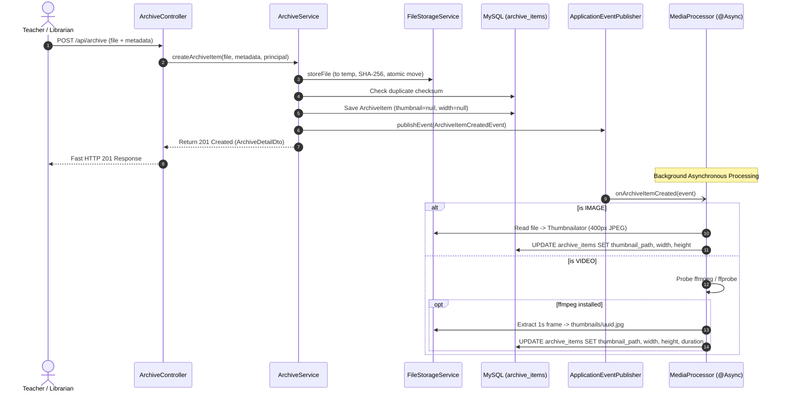

# Implementation Plan - Phase 4: Archive and Media Processing

## 1. Goal Description
Phase 4 implements the **School Archive** module for storing and showcasing school history (historical photos, documentation videos, official event documents). 
It features:
* **Archive Upload & Management**: Automatic media type detection (`IMAGE`, `VIDEO`, `DOCUMENT`), default `STAFF` visibility, checksum deduplication (`409 Conflict`), and soft deletion.
* **HTTP Byte-Range Video Streaming**: Seamless seeking/scrubbing for MP4, WebM, and MKV videos via the shared `RangeFileResponder`.
* **Asynchronous Media Processing**: Decoupled `MediaProcessor` listening for upload events over a dedicated executor (`AsyncConfig`) to extract dimensions, duration, and generate ~400px poster thumbnails using `Thumbnailator` and optional `ffmpeg`/`ffprobe`.
* **Catalog & Full-Text Search**: Filter by category, media type, date range (`from` to `to`), with MySQL FULLTEXT search on `title` and `description` (with `LIKE` fallback for queries < 3 characters).

---

## 2. User Review Required

> [!IMPORTANT]
> **1. Visibility Default for Archive Items**:
> Unlike books (which default to `PUBLIC`), archive items default to **`STAFF`** visibility per the specification (`backend-spec.md`). Only items explicitly designated as `PUBLIC` by a teacher or librarian will be visible to anonymous students over the Wi-Fi. Anonymous requests for `STAFF` items will return HTTP `404 Not Found`.
>
> **2. Shared `Visibility` Enum**:
> Currently, `Visibility.java` resides in `id.sch.sman11garut.library.book`. To uphold modular monolith dependency rules (where `book` and `archive` do not depend directly on each other), we will move `Visibility.java` to `id.sch.sman11garut.library.common` so both modules can share it cleanly.
>
> **3. Optional `ffmpeg` & `ffprobe` Graceful Degradation**:
> For video uploads, `MediaProcessor` checks if `ffmpeg`/`ffprobe` are installed on the OS. If present, it extracts width, height, duration, and grabs a poster frame at 1s. If `ffmpeg` is not installed or fails, metadata remains null and `/api/archive/{id}/thumbnail` gracefully serves an SVG video icon placeholder.

---

## 3. Open Questions
* None. All requirements strictly align with [backend-spec.md](file:///c:/Users/lenovo/Documents/GitHub/TPLM/backend_sman_11_garut_library/backend-spec.md) and [backend-architecture.md](file:///c:/Users/lenovo/Documents/GitHub/TPLM/backend_sman_11_garut_library/backend-architecture.md).

---

## 4. Proposed Architecture & Event Flow



---

## 5. Proposed Changes

### Component 1: Shared Enums & Asynchronous Configuration

#### [MODIFY] `library/src/main/java/id/sch/sman11garut/library/book/Visibility.java` &rarr; Move to `common/Visibility.java`
Move `Visibility` enum (`PUBLIC`, `STAFF`) to package `id.sch.sman11garut.library.common` and update imports in `Book.java`, `BookSummaryDto.java`, `BookDetailDto.java`, `BookMetadataRequest.java`, `UpdateBookRequest.java`, and `BookSpecifications.java`.

#### [NEW] `library/src/main/java/id/sch/sman11garut/library/config/AsyncConfig.java`
Configures asynchronous execution and dedicated thread pools:
- Enables `@EnableAsync`
- `mediaExecutor`: Thread pool (core: 2, max: 4, queue: 50) dedicated to thumbnail and video processing without blocking web request threads.

---

### Component 2: Media Processing Module (`id.sch.sman11garut.library.media`)

#### [NEW] `ArchiveItemCreatedEvent.java`
In-process domain event:
```java
public record ArchiveItemCreatedEvent(
    Long itemId,
    String storedPath,
    MediaType mediaType,
    String mimeType
) {}
```

#### [NEW] `MediaProcessor.java`
- Listens to `ArchiveItemCreatedEvent` asynchronously via `@Async("mediaExecutor") @EventListener`.
- **Image Processing**:
  - Uses `Thumbnailator` (`Thumbnails.of(...)`) to inspect image dimensions and output a ~400px JPEG thumbnail into `thumbnails/<uuid>.jpg`.
- **Video Processing**:
  - Runs cached OS detection for `ffprobe` and `ffmpeg` via `ProcessBuilder`.
  - If available, runs `ffprobe` to parse duration, width, and height.
  - Runs `ffmpeg -ss 00:00:01 -i <videoPath> -vframes 1 -q:v 2 <thumbnailPath>` to generate a 1-second poster frame.
- Updates database row via `ArchiveRepository.updateMediaMetadata(id, thumbnailPath, width, height, durationSeconds)`.

---

### Component 3: Archive Feature (`id.sch.sman11garut.library.archive`)

#### [NEW] `MediaType.java`
Enum: `IMAGE`, `VIDEO`, `DOCUMENT`. Helper to resolve from MIME:
- `image/*` &rarr; `IMAGE`
- `video/*` &rarr; `VIDEO`
- others &rarr; `DOCUMENT`

#### [NEW] `ArchiveItem.java`
JPA Entity mapped to table `archive_items`:
- `id` (`Long`)
- `title`, `description` (`TEXT`)
- `mediaType` (`@Enumerated(EnumType.STRING) MediaType`)
- `category` (`@ManyToOne ArchiveCategory`)
- `eventDate` (`LocalDate`)
- `visibility` (`Visibility` defaulting to `STAFF`)
- `originalName`, `storedPath`, `mimeType`, `fileSize`, `checksumSha256` (`columnDefinition = "CHAR(64)"`)
- `thumbnailPath`, `width`, `height`, `durationSeconds` (nullable, filled asynchronously)
- `viewCount` (`int`, default 0)
- `uploadedBy` (`@ManyToOne User`)
- `createdAt`, `updatedAt`, `deletedAt` (`Instant`)

#### [NEW] `ArchiveRepository.java` & `ArchiveSpecifications.java`
- Extends `JpaRepository<ArchiveItem, Long>` and `JpaSpecificationExecutor<ArchiveItem>`.
- `existsByChecksumSha256AndDeletedAtIsNull(String checksum)`
- `findByIdAndDeletedAtIsNull(Long id)`
- `findByUploadedByIdAndDeletedAtIsNullOrderByCreatedAtDesc(Long userId, Pageable pageable)`
- `@Modifying @Query("UPDATE ArchiveItem a SET a.viewCount = a.viewCount + 1 WHERE a.id = :id") void incrementViewCount(Long id);`
- `@Modifying @Query("UPDATE ArchiveItem a SET a.thumbnailPath = :thumb, a.width = :w, a.height = :h, a.durationSeconds = :dur WHERE a.id = :id") void updateMediaMetadata(...);`
- **Native FULLTEXT Search Query**:
  ```sql
  SELECT a.* FROM archive_items a
  WHERE a.deleted_at IS NULL
    AND (:staff = true OR a.visibility = 'PUBLIC')
    AND (:categoryId IS NULL OR a.category_id = :categoryId)
    AND (:mediaType IS NULL OR a.media_type = :mediaType)
    AND (:from IS NULL OR a.event_date >= :from)
    AND (:to IS NULL OR a.event_date <= :to)
    AND MATCH(a.title, a.description) AGAINST (:q IN NATURAL LANGUAGE MODE)
  ```
- **JPA Specification (`ArchiveSpecifications.java`)**:
  - Filters by `deletedAt IS NULL`, `visibility = PUBLIC` (if anonymous), `categoryId`, `mediaType`, `eventDate` range (`from`/`to`), and `LIKE %q%` search fallback.

#### [NEW] DTOs
- `ArchiveSummaryDto`: Compact representation for gallery/grid (id, title, mediaType, eventDate, visibility, thumbnailPath, width, height, durationSeconds, viewCount, categoryName).
- `ArchiveDetailDto`: Full representation including file size, mime type, original filename, uploadedBy info.
- `ArchiveMetadataRequest`: Incoming multipart metadata JSON (`title`, `description`, `categoryId`, `eventDate`, `visibility`).
- `UpdateArchiveRequest`: Incoming metadata update JSON.
- `ArchiveSearchCriteria`: Filter parameters (`q`, `categoryId`, `mediaType`, `from`, `to`, `sort`).

#### [NEW] `ArchiveService.java`
- `listArchiveItems(ArchiveSearchCriteria criteria, boolean isStaff, Pageable pageable)`: Returns `PageResponse<ArchiveSummaryDto>` using `resolveNativePageable` (with SQL column names `created_at`, `event_date`, `title`) or `resolveJpaPageable` (with entity property names).
- `getArchiveItem(Long id, boolean isStaff)`: Returns `ArchiveDetailDto`. Returns 404 if item is `STAFF` and caller is anonymous.
- `streamArchiveFile(Long id, boolean isStaff, HttpServletRequest request, HttpServletResponse response)`: Delegates to `RangeFileResponder.write(...)` for video seeking and document streaming.
- `downloadArchiveFile(Long id, boolean isStaff, HttpServletRequest request, HttpServletResponse response)`: Sets attachment header, increments `viewCount`, and streams file.
- `getArchiveThumbnail(Long id, HttpServletRequest request, HttpServletResponse response)`:
  - If `thumbnailPath` is set: streams thumbnail image via `RangeFileResponder`.
  - If null: serves SVG placeholder based on `mediaType` (Image icon, Video icon, or Document icon).
- `createArchiveItem(MultipartFile file, ArchiveMetadataRequest metadata, UserPrincipal principal)`:
  - Detects `MediaType` from sniffed MIME type (`StorageCategory.ARCHIVE`).
  - Checks duplicate checksum &rarr; 409 Conflict.
  - Saves entity (`visibility` defaults to `STAFF`).
  - Publishes `ArchiveItemCreatedEvent` for async processing.
  - Compensation: deletes stored file if DB transaction fails.
- `updateArchiveItem(Long id, UpdateArchiveRequest request, UserPrincipal principal)`: Enforces ownership (Teacher can only update own; Librarian can update any).
- `deleteArchiveItem(Long id, UserPrincipal principal)`: Soft delete. Enforces ownership.
- `restoreArchiveItem(Long id)`: Undoes soft delete (Librarian only).
- `listMyArchiveItems(UserPrincipal principal, Pageable pageable)`: Lists uploads by current user.

#### [NEW] `ArchiveController.java` (`/api/archive/**`)
- `GET /api/archive`
- `GET /api/archive/{id}`
- `GET /api/archive/{id}/file` (HTTP Range streaming)
- `GET /api/archive/{id}/download`
- `GET /api/archive/{id}/thumbnail`
- `GET /api/archive/mine`
- `POST /api/archive` (multipart)
- `PUT /api/archive/{id}`
- `DELETE /api/archive/{id}`

#### [NEW] `ArchiveAdminController.java` (`/api/admin/archive`)
- `POST /api/admin/archive/{id}/restore` (`@PreAuthorize("hasRole('LIBRARIAN')")`)

---

## 6. Verification Plan

### Automated Verification
```powershell
mvn test-compile -f library/pom.xml
```

### Manual Testing Guide (Postman Format)

#### Environment Variables
Configure the following variables in your Postman Environment:
| Variable | Initial Value | Notes |
|---|---|---|
| `baseUrl` | `http://localhost:8081` | Dev backend server port |
| `adminToken` | *(empty)* | Populated by Request 1 Tests script |
| `archiveId` | `1` | Populated by Request 2 Tests script |
| `videoId` | `2` | Populated by Request 5 Tests script |
| `staffItemId` | `3` | Populated by Request 7 Tests script |

---

#### Request 1: Admin Login (Obtain Token)
* **Method**: `POST`
* **URL**: `{{baseUrl}}/api/auth/login`
* **Headers**:
  * `Content-Type: application/json`
* **Body** (`raw` - JSON):
  ```json
  {
    "username": "admin",
    "password": "admin123"
  }
  ```
* **Postman Tests Script**:
  ```javascript
  pm.test("Status code is 200", function () {
      pm.response.to.have.status(200);
      var jsonData = pm.response.json();
      pm.environment.set("adminToken", jsonData.token);
  });
  ```

---

#### Request 2: Upload Archive Image (Public)
* **Method**: `POST`
* **URL**: `{{baseUrl}}/api/archive`
* **Headers**:
  * `Authorization: Bearer {{adminToken}}`
* **Body** (`form-data`):
  | Key | Type | Value / File | Content-Type |
  |---|---|---|---|
  | `file` | `File` | *(Select `.jpg` or `.png` photo)* | `image/jpeg` |
  | `metadata` | `Text` | `{"title":"Upacara HUT RI ke-81","description":"Dokumentasi upacara bendera 17 Agustus","categoryId":1,"eventDate":"2026-08-17","visibility":"PUBLIC"}` | `application/json` |
* **Postman Tests Script**:
  ```javascript
  pm.test("Status code is 201", function () {
      pm.response.to.have.status(201);
      var jsonData = pm.response.json();
      pm.environment.set("archiveId", jsonData.id);
  });
  ```
* **Expected Response** (`201 Created`):
  ```json
  {
    "id": 1,
    "title": "Upacara HUT RI ke-81",
    "description": "Dokumentasi upacara bendera 17 Agustus",
    "mediaType": "IMAGE",
    "visibility": "PUBLIC",
    "originalName": "photo.jpg",
    "mimeType": "image/jpeg"
  }
  ```

---

#### Request 3: Verify Async Thumbnail & Dimensions Extraction
*(Wait 1–2 seconds after uploading to allow the asynchronous `MediaProcessor` to finish).*
* **Method**: `GET`
* **URL**: `{{baseUrl}}/api/archive/{{archiveId}}`
* **Headers**: *(None)*
* **Expected Response** (`200 OK`):
  * `mediaType`: `"IMAGE"`
  * `thumbnailPath`: Populated (e.g., `"thumbnails/2026/11/...jpg"`)
  * `width` and `height`: Extracted positive integers (e.g., `1920` and `1080`).

---

#### Request 4: Get Thumbnail Image / Placeholder
* **Method**: `GET`
* **URL**: `{{baseUrl}}/api/archive/{{archiveId}}/thumbnail`
* **Headers**: *(None)*
* **Expected Response** (`200 OK`):
  * Returns JPEG thumbnail image (`Content-Type: image/jpeg`), or fallback SVG placeholder (`Content-Type: image/svg+xml`).

---

#### Request 5: Upload Video (MP4 / WebM / MKV)
* **Method**: `POST`
* **URL**: `{{baseUrl}}/api/archive`
* **Headers**:
  * `Authorization: Bearer {{adminToken}}`
* **Body** (`form-data`):
  | Key | Type | Value / File | Content-Type |
  |---|---|---|---|
  | `file` | `File` | *(Select a sample `.mp4`, `.webm`, or `.mkv` file)* | `video/mp4` *(or `video/webm` / `video/x-matroska`)* |
  | `metadata` | `Text` | `{"title":"Pentas Seni 2026","description":"Video rekaman pentas seni tahunan","eventDate":"2026-05-10","visibility":"PUBLIC"}` | `application/json` |
* **Postman Tests Script**:
  ```javascript
  pm.test("Status code is 201", function () {
      pm.response.to.have.status(201);
      var jsonData = pm.response.json();
      pm.environment.set("videoId", jsonData.id);
  });
  ```
* **Expected Response** (`201 Created`):
  ```json
  {
    "id": 2,
    "title": "Pentas Seni 2026",
    "mediaType": "VIDEO",
    "visibility": "PUBLIC"
  }
  ```

---

#### Request 6: Test HTTP Range Video Seeking (Scrubbing)
* **Method**: `GET`
* **URL**: `{{baseUrl}}/api/archive/{{videoId}}/file`
* **Headers**:
  * `Range: bytes=0-1048575` *(Request first 1 MB)*
* **Expected Response** (`206 Partial Content`):
  * Headers:
    * `Content-Range: bytes 0-1048575/<total_file_size>`
    * `Accept-Ranges: bytes`
  * Body: First 1MB of video stream.

---

#### Request 7: Upload Internal Document (Default `STAFF` Visibility)
* **Method**: `POST`
* **URL**: `{{baseUrl}}/api/archive`
* **Headers**:
  * `Authorization: Bearer {{adminToken}}`
* **Body** (`form-data`):
  | Key | Type | Value / File | Content-Type |
  |---|---|---|---|
  | `file` | `File` | *(Select a `.pdf` or `.docx`)* | `application/pdf` |
  | `metadata` | `Text` | `{"title":"SK Rapat Dewan Guru"}` | `application/json` |
* **Postman Tests Script**:
  ```javascript
  pm.test("Status code is 201", function () {
      pm.response.to.have.status(201);
      var jsonData = pm.response.json();
      pm.environment.set("staffItemId", jsonData.id);
  });
  ```
* **Expected Response** (`201 Created`):
  * `visibility`: `"STAFF"` (defaulted automatically).

---

#### Request 8: Test STAFF Visibility Restriction (Anonymous Request)
* **Method**: `GET`
* **URL**: `{{baseUrl}}/api/archive/{{staffItemId}}`
* **Headers**: *(None - Anonymous)*
* **Expected Response** (`404 Not Found`):
  ```json
  {
    "status": 404,
    "code": "NOT_FOUND",
    "message": "Archive item not found with id: 3"
  }
  ```

---

#### Request 9: Test STAFF Visibility (Authenticated Request)
* **Method**: `GET`
* **URL**: `{{baseUrl}}/api/archive/{{staffItemId}}`
* **Headers**:
  * `Authorization: Bearer {{adminToken}}`
* **Expected Response** (`200 OK`): Full item metadata returned successfully.

---

#### Request 10: Anonymous Full-Text Search & Filters
* **Method**: `GET`
* **URL**: `{{baseUrl}}/api/archive?q=pentas&mediaType=VIDEO`
* **Headers**: *(None)*
* **Expected Response** (`200 OK`):
  ```json
  {
    "content": [
      {
        "id": 2,
        "title": "Pentas Seni 2026",
        "mediaType": "VIDEO",
        "visibility": "PUBLIC",
        "viewCount": 0
      }
    ],
    "totalElements": 1,
    "last": true
  }
  ```

---

#### Request 11: Download Archive File
* **Method**: `GET`
* **URL**: `{{baseUrl}}/api/archive/{{videoId}}/download`
* **Headers**: *(None)*
* **Expected Response** (`200 OK`):
  * Headers: `Content-Disposition: attachment; filename="..."`
  * Note: Increments `viewCount` by 1.

---

#### Request 12: List My Uploads (Staff Only)
* **Method**: `GET`
* **URL**: `{{baseUrl}}/api/archive/mine`
* **Headers**:
  * `Authorization: Bearer {{adminToken}}`
* **Expected Response** (`200 OK`): Paginated list of archive items uploaded by the authenticated user.

---

#### Request 13: Soft Delete Archive Item
* **Method**: `DELETE`
* **URL**: `{{baseUrl}}/api/archive/{{archiveId}}`
* **Headers**:
  * `Authorization: Bearer {{adminToken}}`
* **Expected Response** (`204 No Content`):
  * Calling Request 3 (`GET {{baseUrl}}/api/archive/{{archiveId}}`) will now return `404 Not Found`.

---

#### Request 14: Restore Soft-Deleted Item (Librarian Only)
* **Method**: `POST`
* **URL**: `{{baseUrl}}/api/admin/archive/{{archiveId}}/restore`
* **Headers**:
  * `Authorization: Bearer {{adminToken}}`
* **Expected Response** (`200 OK`):
  * Item is un-deleted; subsequent requests to view the item will succeed again with `200 OK`.

---

## 7. Runtime Issues & Applied Fixes

### Issue 1: WebM and MKV Uploads Rejected with `400 INVALID_FILE_TYPE: File type is not allowed`
* **Root Cause**: WebM and MKV both use the **EBML** container format (`\x1A\x45\xDF\xA3`). In `FileTypeDetector.sniff()`, Apache Tika was called in stream-only mode (`tika.detect(InputStream)`) without passing filename metadata. Without the filename hint, Tika detected `.webm` files as raw `application/x-matroska`. Because `application/x-matroska` was not in `ARCHIVE_MIMES`, the detector rejected it with `400 Bad Request`.
* **Fix**:
  1. Updated `FileTypeDetector.sniff()` to pass `Metadata` populated with `TikaCoreProperties.RESOURCE_NAME_KEY = originalFilename` so Tika utilizes both magic bytes and extension.
  2. Added container fallback normalization: if Tika detects `application/x-matroska` or `video/x-matroska` with a `.webm` extension, it normalizes to `video/webm`.
  3. Added `.mkv` (`video/x-matroska`) directly to `ARCHIVE_MIMES`, `EXTENSIONS_BY_MIME`, and `CANONICAL_EXTENSION`, providing first-class support for both `.webm` and `.mkv` video uploads.
