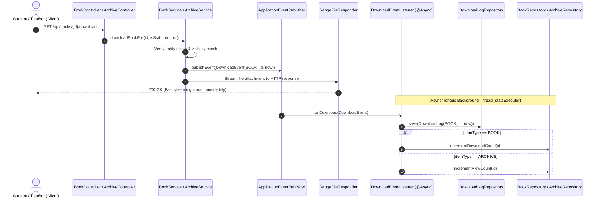

# Implementation Plan - Phase 5: Stats, Events, and Asynchronous Download Counters

## 1. Goal Description
Phase 5 implements the asynchronous event-driven download logging and statistics subsystem for Perpustakaan Digital Lokal SMAN 11 Garut.
Key deliverables:
* **Asynchronous Event-Driven Counters**: Decouple file streaming from statistics writes. When `/download` is invoked for either a book or an archive item, an in-process `DownloadEvent` is published, allowing file streaming to start immediately over the local Wi-Fi without blocking on database writes.
* **Download Log Recording**: A dedicated asynchronous listener (`DownloadEventListener`) persists an entry into `download_logs` (`item_type`, `item_id`, `downloaded_at`) and atomically increments the target item's counter (`books.download_count` or `archive_items.view_count`).
* **Isolated Thread Pool**: A dedicated `statsExecutor` in `AsyncConfig` so stats handling runs on a non-blocking queue (`core=1`, `max=2`, `queue=500`) without competing with heavy media/thumbnail processing (`mediaExecutor`).
* **Librarian Statistics API**: `GET /api/admin/stats` providing overall inventory totals, downloads today / this week, 7-day daily trends, distribution by book type and archive media type, and top downloaded books.

---

## 2. User Review Required

> [!IMPORTANT]
> **1. Event-Driven Decoupling from Streaming**:
> Previously, `BookService.downloadBookFile` and `ArchiveService.downloadArchiveFile` executed synchronous SQL `UPDATE` statements to increment counters within the HTTP request thread before or during file streaming.
> In Phase 5, synchronous database updates are removed from the streaming path. The service publishes a `DownloadEvent` and immediately delegates to `RangeFileResponder`. Database insertion into `download_logs` and counter updates occur asynchronously via `@Async("statsExecutor")`.
>
> **2. Admin Stats Endpoint Scope**:
> While `backend-phases.md` lists `DownloadEvent` and `DownloadLog` under Phase 5 and mentions general admin stats in Phase 7, implementing `GET /api/admin/stats` alongside Phase 5 allows immediate end-to-end verification of download logs, trends, and counters via Postman.

---

## 3. Open Questions
* None. All schema definitions exist in `V1__create_initial_schema.sql` (`download_logs`), and architectural rules follow [backend-architecture.md](file:///c:/Users/lenovo/Documents/GitHub/TPLM/backend_sman_11_garut_library/library/.md/backend-architecture.md).

---

## 4. Proposed Architecture & Event Flow



---

## 5. Proposed Changes

### Component 1: Asynchronous Configuration Update

#### [MODIFY] `library/src/main/java/id/sch/sman11garut/library/config/AsyncConfig.java`
Add dedicated `statsExecutor` thread pool to isolate lightweight statistics writes from CPU-bound media processing:
```java
@Bean("statsExecutor")
public Executor statsExecutor() {
    ThreadPoolTaskExecutor executor = new ThreadPoolTaskExecutor();
    executor.setCorePoolSize(1);
    executor.setMaxPoolSize(2);
    executor.setQueueCapacity(500);
    executor.setThreadNamePrefix("stats-");
    executor.initialize();
    return executor;
}
```

---

### Component 2: Statistics & Download Event Subsystem (`id.sch.sman11garut.library.stats`)

#### [NEW] `ItemType.java`
Enum matching the MySQL `download_logs.item_type` column:
```java
package id.sch.sman11garut.library.stats;

public enum ItemType {
    BOOK,
    ARCHIVE
}
```

#### [NEW] `DownloadEvent.java`
In-process domain event record:
```java
package id.sch.sman11garut.library.stats;

import java.time.Instant;

public record DownloadEvent(
    ItemType itemType,
    Long itemId,
    Instant downloadedAt
) {}
```

#### [NEW] `DownloadLog.java`
JPA Entity mapped to existing table `download_logs`:
* `id` (`Long`, `@Id @GeneratedValue(strategy = GenerationType.IDENTITY)`)
* `itemType` (`@Enumerated(EnumType.STRING) @Column(name = "item_type", nullable = false, length = 20)`)
* `itemId` (`@Column(name = "item_id", nullable = false) Long`)
* `downloadedAt` (`@Column(name = "downloaded_at", nullable = false, updatable = false) Instant`)

#### [NEW] `DownloadLogRepository.java`
Extends `JpaRepository<DownloadLog, Long>`:
* `long countByDownloadedAtAfter(Instant after)`
* `long countByItemType(ItemType itemType)`
* `long countByItemTypeAndDownloadedAtAfter(ItemType itemType, Instant after)`
* Native query for 7-day daily trend aggregation:
  ```sql
  SELECT DATE(downloaded_at) as dl_date, COUNT(*) as dl_count
  FROM download_logs
  WHERE downloaded_at >= :since
  GROUP BY DATE(downloaded_at)
  ORDER BY dl_date ASC
  ```

#### [NEW] DTOs for Admin Stats
* `TopBookDto(Long id, String title, String author, int downloadCount)`
* `DailyTrendDto(String date, long count)`
* `AdminStatsDto`:
  * `totalBooks` (`long`)
  * `totalArchiveItems` (`long`)
  * `totalDownloads` (`long`)
  * `downloadsToday` (`long`)
  * `downloadsThisWeek` (`long`)
  * `booksByType` (`Map<String, Long>`)
  * `archiveByMediaType` (`Map<String, Long>`)
  * `topBooks` (`List<TopBookDto>`)
  * `dailyDownloads` (`List<DailyTrendDto>`)

#### [NEW] `DownloadEventListener.java`
Event listener component:
* Annotated with `@Async("statsExecutor") @EventListener`
* Listens to `DownloadEvent`:
  * Inserts new `DownloadLog` into database.
  * Calls `bookRepository.incrementDownloadCount(itemId)` or `archiveRepository.incrementViewCount(itemId)` in an asynchronous `@Transactional` method.
  * Catches and logs any unexpected exceptions without impacting callers.

#### [NEW] `StatsService.java`
Service providing aggregation queries for `AdminStatsDto`:
* Computes `downloadsToday` (from `LocalDate.now().atStartOfDay(ZoneId.systemDefault()).toInstant()`).
* Computes `downloadsThisWeek` (last 7 days).
* Aggregates book types distribution and archive media types distribution.
* Fetches top 5 downloaded books via `bookRepository.findTop5ByDeletedAtIsNullOrderByDownloadCountDesc()`.
* Parses daily trend rows into `List<DailyTrendDto>`.

#### [NEW] `AdminStatsController.java`
REST Controller at `/api/admin/stats`:
* Protected by `@PreAuthorize("hasRole('LIBRARIAN')")`.
* `GET /api/admin/stats` &rarr; returns `ResponseEntity<AdminStatsDto>`.

---

### Component 3: Integration into Books and Archive Services

#### [MODIFY] `library/src/main/java/id/sch/sman11garut/library/book/BookRepository.java`
Add query methods for statistics aggregation:
* `long countByDeletedAtIsNull();`
* `List<Book> findTop5ByDeletedAtIsNullOrderByDownloadCountDesc();`
* `@Query("SELECT b.bookType, COUNT(b) FROM Book b WHERE b.deletedAt IS NULL GROUP BY b.bookType") List<Object[]> countGroupedByBookType();`

#### [MODIFY] `library/src/main/java/id/sch/sman11garut/library/archive/ArchiveRepository.java`
Add query methods for statistics aggregation:
* `long countByDeletedAtIsNull();`
* `@Query("SELECT a.mediaType, COUNT(a) FROM ArchiveItem a WHERE a.deletedAt IS NULL GROUP BY a.mediaType") List<Object[]> countGroupedByMediaType();`

#### [MODIFY] `library/src/main/java/id/sch/sman11garut/library/book/BookService.java`
* Inject `ApplicationEventPublisher`.
* In `downloadBookFile`:
  * Remove synchronous `bookRepository.incrementDownloadCount(book.getId())`.
  * Add `eventPublisher.publishEvent(new DownloadEvent(ItemType.BOOK, book.getId(), Instant.now()))`.

#### [MODIFY] `library/src/main/java/id/sch/sman11garut/library/archive/ArchiveService.java`
* In `downloadArchiveFile`:
  * Remove synchronous `archiveRepository.incrementViewCount(item.getId())`.
  * Add `eventPublisher.publishEvent(new DownloadEvent(ItemType.ARCHIVE, item.getId(), Instant.now()))`.

---

## 6. Verification Plan

### Manual Testing Guide (Postman Format)

#### Environment Variables
Configure the following variables in your Postman Environment:
| Variable | Initial Value | Notes |
|---|---|---|
| `baseUrl` | `http://localhost:8081` | Dev backend server port |
| `adminToken` | *(empty)* | Populated by Request 1 Tests script |
| `bookId` | `1` | Valid active book ID from Phase 3 |
| `archiveId` | `1` | Valid active archive item ID from Phase 4 |

---

#### Request 1: Admin Login (Obtain Token)
* **Method**: `POST`
* **URL**: `{{baseUrl}}/api/auth/login`
* **Headers**:
  * `Content-Type: application/json`
* **Body** (`raw` - JSON):
  ```json
  {
    "username": "admin",
    "password": "admin123"
  }
  ```
* **Postman Tests Script**:
  ```javascript
  pm.test("Status code is 200", function () {
      pm.response.to.have.status(200);
      var jsonData = pm.response.json();
      pm.environment.set("adminToken", jsonData.token);
  });
  ```

---

#### Request 2: Initial Admin Stats Overview (Before Downloads)
* **Method**: `GET`
* **URL**: `{{baseUrl}}/api/admin/stats`
* **Headers**:
  * `Authorization: Bearer {{adminToken}}`
* **Expected Response** (`200 OK`):
  ```json
  {
    "totalBooks": 1,
    "totalArchiveItems": 2,
    "totalDownloads": 0,
    "downloadsToday": 0,
    "downloadsThisWeek": 0,
    "booksByType": {
      "EBOOK": 1
    },
    "archiveByMediaType": {
      "IMAGE": 1,
      "VIDEO": 1
    },
    "topBooks": [],
    "dailyDownloads": []
  }
  ```

---

#### Request 3: Trigger Book Download
* **Method**: `GET`
* **URL**: `{{baseUrl}}/api/books/{{bookId}}/download`
* **Headers**: *(None - Anonymous or Authenticated)*
* **Expected Response** (`200 OK`):
  * Headers: `Content-Disposition: attachment; filename="..."`
  * Body: Binary book stream starts immediately.
  * Note: Emits asynchronous `DownloadEvent(BOOK, 1)`.

---

#### Request 4: Trigger Archive Download
* **Method**: `GET`
* **URL**: `{{baseUrl}}/api/archive/{{archiveId}}/download`
* **Headers**: *(None for PUBLIC items)*
* **Expected Response** (`200 OK`):
  * Headers: `Content-Disposition: attachment; filename="..."`
  * Body: Binary archive stream starts immediately.
  * Note: Emits asynchronous `DownloadEvent(ARCHIVE, 1)`.

---

#### Request 5: Verify Updated Admin Stats & Counters
*(Wait ~500ms after download requests to allow the background thread to execute).*
* **Method**: `GET`
* **URL**: `{{baseUrl}}/api/admin/stats`
* **Headers**:
  * `Authorization: Bearer {{adminToken}}`
* **Expected Response** (`200 OK`):
  * `totalDownloads`: Increased by 2.
  * `downloadsToday`: Increased by 2.
  * `downloadsThisWeek`: Increased by 2.
  * `topBooks`: Contains book ID 1 with positive `downloadCount`.
  * `dailyDownloads`: Contains an entry for today's date with count matching downloads.

---

#### Request 6: Role Security Guard (Non-Librarian Blocked)
* **Method**: `GET`
* **URL**: `{{baseUrl}}/api/admin/stats`
* **Headers**: *(None or Teacher token)*
* **Expected Response** (`401 Unauthorized` or `403 Forbidden`):
  ```json
  {
    "status": 401,
    "code": "UNAUTHORIZED",
    "message": "Full authentication is required to access this resource"
  }
  ```
