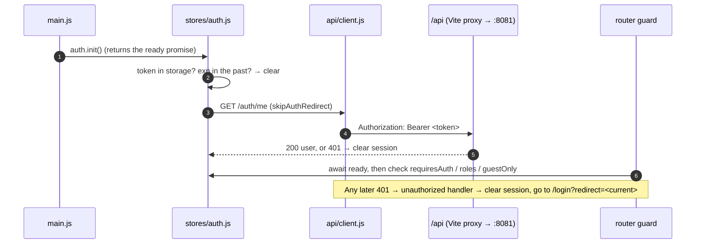

# Stage 1: Foundation (implementation plan and manual testing guide)

> **Status:** Done · **Roadmap:** [Stage 1](frontend-plan.md#stage-1-foundation) · **Backend refs:** [spec §3.4 Auth](../.md/backend-spec.md), [frontend-guide §2 Auth, §7 Errors](../frontend-guide.md)

## 1. Summary
Connect the frontend to the real backend for auth, and remove the features the backend doesn't support. Later stages build on this.

Deliverables:
- A dev proxy from `/api` to `http://localhost:8081`.
- A shared API client: sends the Bearer token, normalizes errors, handles 401.
- An auth store: real login, session restore through `/auth/me`, logout on the JWT `exp`, role getters.
- Router guards based on role (`TEACHER`, `LIBRARIAN`, anonymous).
- A login page for staff only that handles the `400` errors.
- A header with a logged-in user menu and a change-password modal.
- Presensi, visitor statistics and the dead files removed.

**Done when:**
- `npm run build` passes.
- The admin and a teacher can each log in against the real backend and land on their own page.
- Anonymous users are kept out of staff pages.
- An expired or invalid token logs the user out.
- Nothing about presensi or visitor statistics is left in the UI.

---

## 2. Decisions
- **No new dependencies.** The client uses `fetch`. Auth state is a module-level `reactive()` store, since the project has no Pinia. Axios and XHR come in later, for upload progress in stage 4.
- **The token lives in its own module (`src/api/token.js`).** Both the client and the store read it from there, which avoids a circular import (store → auth API → client → store). The `localStorage` keys are `elib_token` and `elib_user`.
- **The client never imports the router.** `main.js` registers the 401 handler with `setUnauthorizedHandler()`, which keeps the modules decoupled.
- **Login never runs the 401 handler**, because it's called with `skipAuthRedirect: true`. A wrong password is `400 INVALID_CREDENTIALS`, per the guide.
- **Logout follows the JWT `exp`, not only a `401`.** Public endpoints ignore expired tokens without saying so. On load, the store checks `exp` before calling `/auth/me`. It sets a timer for the `exp` time and checks again on `visibilitychange`, because timers drift on laptops that go to sleep.
- **If `/auth/me` fails with a network error**, the cached `elib_user` is kept so the backend being briefly down doesn't log anyone out. A `401` clears the session.
- **Only safe redirects.** `?redirect=` is followed only when it starts with `/` and not `//`. Anything else goes to the role's home page.
- **Home page per role:** `LIBRARIAN` → `/admin`, `TEACHER` → `/unggahan`.
- **The temporary pages in this stage:**
  - `/admin/dashboard` keeps the existing `AdminDashboardView` (still mock data until stage 5), but it's now guarded and its logout is real.
  - `/unggahan` is a simple placeholder until stage 4.
- **Some later-stage modules are left out.** `upload.js`, `media.js`, the book/archive/admin endpoint modules and the enum labels are added in the stage that first uses them. The roadmap is updated to say so.
- **The chart code is still in git history.** Deleting `views/statistik/*` is safe because stage 5 can look up the Chart.js setup there (commit `37aec5b`).

---

## 3. Design



### 3.1 `src/api/client.js` contract
```js
request(path, { method = 'GET', query, body, auth = true, skipAuthRedirect = false } = {})
// → parsed JSON, or null for 204. Throws ApiError.
class ApiError extends Error { status; code; message; fieldErrors }
setUnauthorizedHandler(fn)
```
- The URL is `'/api' + path`, plus `query` with `null` and empty values dropped.
- `Content-Type: application/json` is set only when there's a `body`.
- Errors:
  - JSON error body → `new ApiError(body)`.
  - Non-JSON body (proxy or Nginx) → a fallback code by status: `413` → `FILE_TOO_LARGE`, `500`/`502`/`503`/`504` → `SERVER_UNREACHABLE`, anything else → `UNKNOWN_ERROR`.
  - `fetch` itself throws → `ApiError({ status: 0, code: 'NETWORK_ERROR' })`.
- A `401` without `skipAuthRedirect` calls the registered handler before throwing.

### 3.2 `src/stores/auth.js` contract
```js
auth.state            // reactive { token, user, ready }
auth.isLoggedIn / isStaff / isLibrarian / isTeacher   // computed
auth.canEdit(item)    // LIBRARIAN, or item.uploadedById === user.id
auth.homePath()       // '/admin' | '/unggahan' | '/'
auth.init()           // idempotent; resolves when ready
auth.login(username, password)   // stores token+user, schedules expiry; throws ApiError
auth.logout()         // clears token, user, timer
```
- `decodeExp(token)` decodes the base64url payload and returns `exp` in seconds, or `null`. `null` counts as invalid.
- `init()` also deletes the old `auth_role` and `auth_user` keys.

---

## 4. Changes

### 4.1 New files
| File | Purpose |
|---|---|
| `src/api/token.js` | `getToken`, `setToken`, `clearToken`, `getCachedUser`, `setCachedUser` over `localStorage`, each wrapped in try/catch. |
| `src/api/client.js` | `request`, `ApiError`, `setUnauthorizedHandler` (§3.1). |
| `src/api/auth.js` | `login(username, password)`, `me()`, `changePassword(oldPassword, newPassword)`. |
| `src/stores/auth.js` | The auth store (§3.2). |
| `src/utils/errors.js` | `ERROR_MESSAGES` (Indonesian, by `code`, from frontend-guide §7.1, plus the fallback codes) and `errorMessage(err)`. For `ACCOUNT_TEMPORARILY_LOCKED`, `errorMessage` returns the server's message, which says how long to wait. |
| `src/utils/labels.js` | `ROLE_LABELS` (`LIBRARIAN` → "Pustakawan", `TEACHER` → "Guru"). Enum labels are added in stage 2. |
| `src/components/ChangePasswordModal.vue` | Uses `components/ui/BaseModal.vue`, `BaseInput.vue` and `BaseButton.vue`. Fields: old password, new password (6+ characters), confirm. `INVALID_OLD_PASSWORD` shows under the old password field, `SAME_PASSWORD` under the new one, `VALIDATION_FAILED` follows `fieldErrors`. On success, a message and the modal closes. |
| `src/views/staff/UnggahanSayaView.vue` | A placeholder card: "Halo, {fullName}. Fitur unggahan hadir di tahap berikutnya." It's replaced in stage 4. |

### 4.2 Modified files
| File | Change |
|---|---|
| `vite.config.js` | `server: { proxy: { '/api': { target: 'http://localhost:8081', changeOrigin: true } } }` |
| `src/main.js` | `auth.init()`, then `setUnauthorizedHandler(() => { auth.logout(); router.push({ name: 'Login', query: { redirect: router.currentRoute.value.fullPath, expired: '1' } }) })`, then mount. |
| `src/router/index.js` | Removes the routes and imports for `PresensiPage`, `statistik/*`, `BerandaPage` and `AdminDashboardPage`. Remaining routes: `/login` (`guestOnly`, `hideNavbar`), `/`, `/katalog` → `/`, `/kategori` (alias `/search`), `/buku/:id`, `/unggahan` (`requiresAuth`, `roles: ['TEACHER','LIBRARIAN']`), `/admin` → `/admin/dashboard`, `/admin/dashboard` (`roles: ['LIBRARIAN']`, `hideNavbar`), catch-all → `/`. The `beforeEach` awaits `auth.init()`, then: a guest on a protected route → `Login` with `redirect`; wrong role → `auth.homePath()`; logged in on `guestOnly` → `auth.homePath()`. The `afterEach` title logic stays. |
| `src/views/auth/LoginView.vue` | Same visual design. Removes the user/admin segmented control, `activeRole`, `switchRole`, the prefilled fake credentials, the simulated delays and the commented-out `/api/v1` code. Always shows the username and password fields. Labels: "Nama Pengguna" and "Kata Sandi"; the hint becomes "Min. 6 Karakter" and the badge "Guru & Pustakawan". Submit calls `auth.login()`. On success, a short message, then `router.replace(safeRedirect ?? auth.homePath())`. On error, `errorMessage(err)` (the `INVALID_CREDENTIALS` text is "Nama pengguna atau kata sandi salah."). `?expired=1` shows a notice: "Sesi Anda telah berakhir, silakan masuk kembali." |
| `src/components/HeaderNavbar.vue` | Removes the Presensi and Statistik nav links and the "Presensi Siswa" button. Keeps Katalog, Cari & Filter and the book icon button. Logged out: a "Masuk Staf" button → `/login`. Logged in: the avatar opens a dropdown with `fullName`, the `ROLE_LABELS` role, "Unggahan Saya" (`/unggahan`), "Panel Admin" (librarian only, `/admin`), "Ganti Kata Sandi" (opens `ChangePasswordModal`) and "Keluar" (`auth.logout()` → `/`). The dropdown closes on outside click, Esc and route change. Removes the unused `localStorage` code. |
| `src/components/FooterSection.vue` | Removes the "Presensi Pengunjung" and "Statistik Pengunjung" links. Turns Katalog, Cari & Filter and Portal Masuk Petugas into `<router-link>`s (`/`, `/kategori`, `/login`). "Arsip & Berita" stays as it is until stage 3. |
| `src/views/KatalogView.vue` | The hero's "Presensi Mandiri Hari Ini" button becomes "Jelajahi Koleksi" → `/kategori`. The mock data stays until stage 2. |
| `src/views/admin/AdminDashboardView.vue` | `handleLogout` → `auth.logout()` then `router.push('/login')`. The banner name and role come from `auth.state.user`. Removes the "Pengunjung Hari Ini" stat card (the grid becomes `md:grid-cols-2`). The rest stays as it is until stage 5. |

### 4.3 Deleted files
`views/PresensiPage.vue`, `components/FormPresensi.vue`, `components/PengunjungTerkiniSidebar.vue`, all 6 `views/statistik/*.vue`, `views/BerandaPage.vue`, `views/KategoriPage.vue`, `views/buku/DetailBukuPage.vue`, `views/admin/AdminDashboardPage.vue`.

Kept for later stages: `components/ui/*` (stage 5 admin pages) and `components/admin/*` (stage 4).

### 4.4 Roadmap update
In `frontend .md/frontend-plan.md`:
- Mark Stage 1 as "In progress" when work starts and "Done" at the end.
- Note that `upload.js`, `media.js` and the endpoint modules move to stages 2–4.
- Change `AdminDashboardView` so it's deleted in stage 5.

---

## 5. Manual testing guide

### 5.1 Setup
| Item | Value |
|---|---|
| Backend | Running with the dev profile on `http://localhost:8081`. Check with `http://localhost:8081/api/health` → `{"status":"UP",...}`. |
| Frontend | `npm install` (first time only), then `npm run dev` → `http://localhost:5173` |
| Librarian | `admin` / `admin123` (dev seed) |
| Teacher | Created in Test 6. Use `guru_uji` / `guru1234` |
| Tools | Browser DevTools: the **Network** tab (filter `api`), the **Application → Local Storage** panel and the **Console** |

Before each test group, start clean: `localStorage.clear(); location.reload()` in the Console.

### 5.2 Build and cleanup checks
| # | Step | Expected |
|---|---|---|
| 1 | `npm run build` | Finishes with no errors and no "failed to resolve import" warnings. |
| 2 | Search `src/` for `Presensi\|presensi\|statistik/\|BerandaPage\|KategoriPage\|DetailBukuPage\|AdminDashboardPage\|auth_role` | No matches, except `auth_role` in `src/api/token.js`, which is the code that removes the old key. "Statistik" text inside `AdminDashboardView` is allowed. |

### 5.3 Anonymous visitor
| # | Step | Expected |
|---|---|---|
| 3 | Open `/` | The catalog loads. Header shows Katalog, Cari & Filter and a **Masuk Staf** button, with no Presensi or Statistik. The hero shows **Jelajahi Koleksi** and it goes to `/kategori`. The footer has no Presensi or Statistik links, and "Portal Masuk Petugas" goes to `/login`. |
| 4 | Open `/presensi`, `/statistik/harian`, `/apa-saja` | Each redirects to `/`. |
| 5 | Open `/admin/dashboard`, then `/unggahan` | Each redirects to `/login?redirect=%2Fadmin%2Fdashboard` (or `%2Funggahan`). The header and footer are hidden on the login page. |

### 5.4 Login: librarian
| # | Step | Expected |
|---|---|---|
| 6a | On `/login`, check the form | There's no User/Admin toggle and the fields aren't prefilled. The password hint says "Min. 6 Karakter". |
| 6b | Sign in as `admin` with a wrong password | Network: `POST /api/auth/login` → **400**. The form shows "Nama pengguna atau kata sandi salah." It stays on `/login`, with no redirect and no "session expired" notice. |
| 6c | Sign in as `admin` / `admin123` | → **200**. Redirects to `/admin/dashboard`. Local Storage has `elib_token` and `elib_user`. The banner shows the librarian's `fullName` from the backend. The "Pengunjung Hari Ini" card is gone. |
| 6d | In the Console, create a teacher using the librarian's token: `fetch('/api/admin/users',{method:'POST',headers:{'Content-Type':'application/json',Authorization:'Bearer '+localStorage.getItem('elib_token')},body:JSON.stringify({username:'guru_uji',password:'guru1234',fullName:'Guru Uji',role:'TEACHER'})}).then(r=>r.status)` | `201`. If it returns `409`, the user already exists, which is also fine. |
| 6e | Go to `/`, then open the avatar menu | It shows the name, "Pustakawan", Unggahan Saya, **Panel Admin**, Ganti Kata Sandi and Keluar. Clicking outside or pressing Esc closes it. |
| 6f | Open `/login` while logged in | Redirects to `/admin/dashboard`. |
| 6g | Reload any page | You're still logged in. Network: `GET /api/auth/me` → 200 with an `Authorization: Bearer …` header. |
| 6h | Avatar menu → **Keluar** | Goes to `/`, the header shows **Masuk Staf**, and the `elib_*` keys are gone. Admin dashboard → **Ganti Akun / Peran** does the same, then goes to `/login`. |

### 5.5 Login: teacher
| # | Step | Expected |
|---|---|---|
| 7a | Sign in as `guru_uji` / `guru1234` | Redirects to `/unggahan`, which shows "Halo, Guru Uji…". |
| 7b | Avatar menu | Shows "Guru", with **no** Panel Admin item. |
| 7c | Open `/admin/dashboard` | Redirects to `/unggahan`. |
| 7d | Log out. Open `/unggahan`, sign in as the teacher | Goes back to `/unggahan` through `?redirect`. |
| 7e | Log out. Open `/login?redirect=//example.com`, then sign in | Lands on `/unggahan`, not on example.com. |

### 5.6 Change password (as the teacher)
| # | Step | Expected |
|---|---|---|
| 8a | Avatar → Ganti Kata Sandi. Enter a wrong old password | → 400. The error "Kata sandi lama salah" shows under the old password field. |
| 8b | Correct old password, and the same value as the new one | The `SAME_PASSWORD` error shows under the new password field. |
| 8c | New password `abc` | Blocked in the browser (min 6 characters). No request is sent. |
| 8d | Old `guru1234`, new `guru5678`, confirm matches | → 200. A success message, then the modal closes. |
| 8e | Log out. Sign in with `guru1234` | Fails with "Nama pengguna atau kata sandi salah". Signing in with `guru5678` works. |

### 5.7 Session expiry and invalid tokens
Use the Console helper `const b=o=>btoa(JSON.stringify(o)).replace(/=+$/,'').replace(/\+/g,'-').replace(/\//g,'_')`.

| # | Step | Expected |
|---|---|---|
| 9a | **Expired token:** while logged out, run `localStorage.setItem('elib_token', b({alg:'HS256'})+'.'+b({sub:'admin',exp:Math.floor(Date.now()/1000)-60})+'.x'); location.reload()` | You're logged out (header shows Masuk Staf). The `elib_token` key is removed. Network shows **no** `/auth/me` call, because the `exp` check runs first. |
| 9b | **Forged token, `exp` in the future:** the same command with `exp: Math.floor(Date.now()/1000)+3600`, then reload | `/auth/me` → 401. The session is cleared and you're logged out. The page stays on `/`, with no forced redirect while the app starts. |
| 9c | **401 during a session:** sign in as the teacher, then replace the token *without reloading* (the 9b command without `location.reload()`). Open Ganti Kata Sandi and submit valid values | `/auth/change-password` → 401. You're sent to `/login?redirect=%2Funggahan&expired=1` with the "Sesi Anda telah berakhir" notice. Signing in returns you to `/unggahan`. |
| 9d | **Old keys removed:** `localStorage.setItem('auth_role','admin'); location.reload()` | `auth_role` is gone, and it grants no access to `/admin/dashboard`. |

### 5.8 Backend unavailable and lockout
| # | Step | Expected |
|---|---|---|
| 10a | Stop the backend, then try to sign in | The form shows the `SERVER_UNREACHABLE` message ("Tidak dapat terhubung ke server perpustakaan…"). Nothing breaks and the console shows no uncaught errors. |
| 10b | While logged in, stop the backend and reload | You stay logged in, using the cached user. Start the backend again. |
| 10c | **Do this last, because it locks `guru_uji` for 5 minutes.** Sign in as `guru_uji` with a wrong password 6 times | From the 6th attempt, the message is the server's `ACCOUNT_TEMPORARILY_LOCKED` text, which says how long to wait. |

### 5.9 Sign-off
All of tests 1–10 pass → commit Stage 1 and set its status to **Done** in `frontend-plan.md`.
